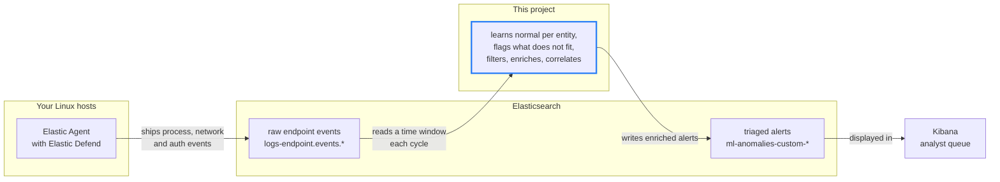
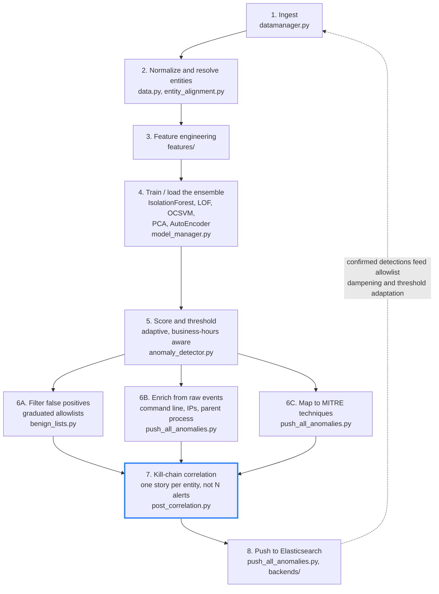
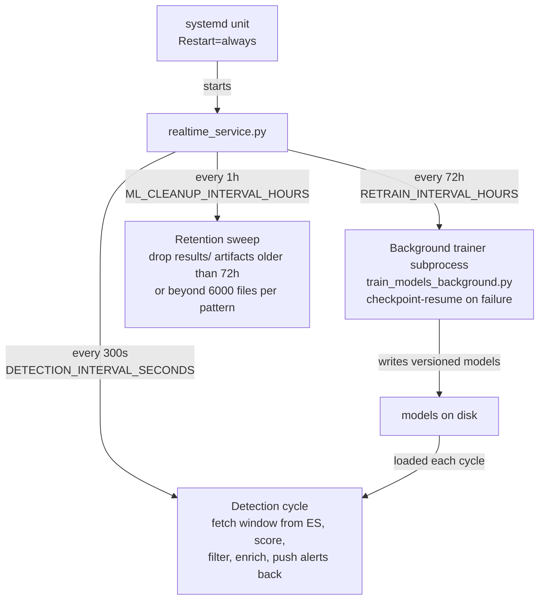

# SOC-in-a-Box

**An open-source, AI-enabled security operations platform for Digital Public Infrastructure, built by the Upanzi Network at CMU-Africa.**

SOC-in-a-Box packages what an organization needs to run a Security Operations
Center into something that can be deployed and adapted quickly. It is aimed at
Digital Public Infrastructure (DPI), Digital Public Goods (DPGs), e-government
platforms, and financial services across African markets, where security teams
are small and most organizations cannot build a SOC from scratch for every system
they run.

It is designed around four ideas:

- **Runs on modest hardware.** Lightweight, containerized, and resource-efficient
  enough for local CPU infrastructure, so data can stay in-country.
- **AI assists the analyst, it does not replace them.** Machine learning and
  agents handle triage, correlation, and routine maintenance. High-impact actions
  stay behind human approval or dry-run defaults.
- **One core, many plugins.** DPI- and sector-specific telemetry, detection rules,
  dashboards, and playbooks (for example, for MOSIP) plug into the core without
  changing it.
- **A training lab as well as a platform.** The same tools serve as a hands-on
  defensive-security lab for students and SOC analysts.

## What is in this repository

This repository holds the SOC-in-a-Box components that sit on top of the Elastic
Stack. The detection engine is always installed; add-ons are optional, and
`./deploy.sh` installs the ones you choose.

| Component | What it does | Where | Status |
|---|---|---|---|
| **Elastic Stack** (Elasticsearch, Kibana, Fleet, Elastic Agent with Elastic Defend, Suricata) | Collects and stores endpoint, network, and authentication telemetry; analyst UI | Deployed separately ([Elastic Security docs](https://www.elastic.co/docs/solutions/security/get-started)), or the bundled demo stack via `deploy.sh --mode docker --local-es` | Foundation |
| **ML anomaly detection engine** | Learns normal behavior per host, user, and process; turns what does not fit into filtered, enriched, ATT&CK-mapped alerts in Kibana | Repository root (described below) | Core |
| **SIEM Maintenance Agent** | Watches the SOC itself: cluster health, ingestion freshness, a daily Google Chat report, guarded auto-remediation | [`addons/siem-maintenance/`](addons/siem-maintenance/) | Optional add-on |
| **Alert Triage Agent** | AI-assisted investigation of Elastic Security alerts: pulls related events, threat intel, and asset context, and gives a TP/FP verdict; web UI, REST API, and an MCP server for AI clients | [`addons/alert-triage/`](addons/alert-triage/) | Optional add-on |
| DPI plugins (MOSIP first), playbooks, training scenarios | Sector-specific detection content and exercises | Not in this repository yet | Planned |

```bash
./deploy.sh                       # detection engine; asks about each add-on
./deploy.sh --with-maintenance    # detection engine + SIEM Maintenance Agent
./deploy.sh --with-triage         # detection engine + Alert Triage Agent
```

The rest of this README covers the detection engine, which is the core of this
repository. See [Automated install](#automated-install) for `deploy.sh` and
[Add-ons](#add-ons) for the agents.

## Contents

**New here?** Read [Before you start](#before-you-start) first. It takes two
minutes and tells you whether this will work in your environment — most setup
problems are really "the data isn't there yet."

- **Getting started:** [Before you start](#before-you-start) ·
  [Automated install](#automated-install) · [Docker](#docker)
- **Detection engine:** [What it detects](#what-it-detects) ·
  [How it works](#how-it-works) · [Quickstart (manual install)](#quickstart) ·
  [Running it continuously](#running-it-continuously) · [Did it work?](#did-it-work) ·
  [Configuration](#configuration)
- **Add-ons:** [SIEM Maintenance Agent](#optional-add-on-siem-maintenance-agent) ·
  [Alert Triage Agent](#optional-add-on-alert-triage-agent)
- **Reference:** [Troubleshooting](#troubleshooting) ·
  [Project structure](#project-structure) · [Development](#development) ·
  [Contributing](#contributing) · [License](#license)

## Getting started

### Before you start

This is **not** a standalone tool. It reads from an existing Elasticsearch
cluster and does nothing useful without one. Here is the honest list.

#### You must have

| Requirement | Why | How to check |
|---|---|---|
| **Python 3.10 or newer** | Uses 3.10+ type syntax | `python3 --version` |
| **An Elasticsearch 8.x cluster** you can reach, with a username and password | This is both the input and the output | `curl -u USER:PASS https://YOUR_ES:9200` |
| **Elastic Agent installed on the Linux machines you want to watch**, with the **Elastic Defend** integration enabled | Produces the process and network events the models learn from | See the next section |
| **At least 7 days of that data already collected** | Models need history to learn "normal"; 7 days is the default training window for process data | See the next section |

#### The part people miss

The models do not read `/var/log` or run on the machine being monitored. They
read **Elastic Agent data streams** out of Elasticsearch. Specifically:

| Data stream | Comes from | Used for |
|---|---|---|
| `.ds-logs-endpoint.events.process-default-*` | Elastic Defend integration | process detection |
| `.ds-logs-endpoint.events.network-default-*` | Elastic Defend integration | network detection |
| `.ds-logs-endpoint.events.file-default-*` | Elastic Defend integration | file activity |
| `.ds-logs-system.auth-default-*` | System integration | login / sudo detection |

So before anything here will work, you need Elastic Agent enrolled in Fleet on
your Linux hosts with **Elastic Defend** (for endpoint events) and **System**
(for auth logs) added to its policy. That is standard Elastic setup and is
documented by Elastic — this project assumes it is already done.

Run this to confirm you have the data. It should return a non-zero count:

```bash
curl -u "$ES_USERNAME:$ES_PASSWORD" \
  "$ES_HOST/.ds-logs-endpoint.events.process-default-*/_count"
```

- **A number in the thousands or more** → you are ready.
- **`{"count":0,...}`** → Elastic Agent is not shipping endpoint data yet. Fix
  that first; nothing downstream will produce results.
- **`index_not_found_exception`** → the integration has never run, or your
  cluster names its indices differently (see [Step 3](#step-3--check-your-index-names-match)).

#### If you don't have this yet

Be aware of what each shortcut does and does not give you:

- **No Elasticsearch at all?** The bundled Docker setup starts Elasticsearch
  8.12 and Kibana 8.12 for you (see [Docker](#docker)). It does **not** include
  Elastic Agent, so you will still need to enroll an agent against it to get
  endpoint data.
- **Have the cluster but no history yet?** Install the agent, then come back in
  a week. You can still complete steps 1-3 now and verify your configuration
  with `--dry-run`, which needs no data.
- **Just want to read the code?** Steps 1-2 plus the
  [architecture guide](docs/ARCHITECTURE.md) will make sense without a cluster.

### Automated install

`deploy.sh` does the install, `.env` setup, connectivity check, and systemd
units in one pass, and asks whether to add the optional
[SIEM Maintenance Agent](#optional-add-on-siem-maintenance-agent):

```bash
git clone https://github.com/cylab-africa/SOC-in-a-Box-ELK-ML-AgenticAI-.git
cd SOC-in-a-Box-ELK-ML-AgenticAI-
./deploy.sh --dry-run        # see what it would do first
./deploy.sh                  # interactive
./deploy.sh --with-maintenance --mode docker   # or: everything in containers
```

Run `./deploy.sh --help` for all options, including `--non-interactive` for
CI/automation. [DEPLOYMENT.md](DEPLOYMENT.md#0-automated-deployment-deploysh)
covers it in full. The manual steps below are what the script automates.
Models are not trained by the script: the service starts a background
training run on its first cycle, and detections begin once it finishes. To
train up front instead, run Step 4 before starting the service.

### Docker

Starts Elasticsearch 8.12, Kibana 8.12, and the detection container together:

```bash
docker compose --env-file .env -f docker/docker-compose.yml up
```

This does **not** include Elastic Agent, so you still need to enroll an agent
to get endpoint data into it. See
[DEPLOYMENT.md](DEPLOYMENT.md#5-docker-deployment) for pointing the detection
container at an existing production cluster instead.

Add `--profile maintenance` to also start the SIEM Maintenance Agent
container (needs `addons/siem-maintenance/.env`, which `deploy.sh` writes).

## The detection engine

**Finds suspicious activity on Linux servers that rule-based detection misses, and sends it to Kibana as triaged alerts.**

Security rules catch things that are *known* to be bad. This catches things that
are *unusual for your environment* — a process that has never run on that host
before, a login at an hour that user never works, an outbound connection on a
port nothing else uses. It learns what normal looks like from your own logs,
then reports what does not fit.

It is built to reduce noise, not add to it. Anomalies are filtered against
allowlists, enriched with the actual command line and IP addresses behind them,
mapped to MITRE ATT&CK techniques, and grouped into a single story per host
rather than arriving as a dozen separate alerts.

Here is where it sits:



Everything outside the "This project" box already exists in a normal Elastic
deployment. The detection engine is the new piece, and it never runs on the machines
being watched — it only needs network access to Elasticsearch.

### What it detects

7 data groups (process, network, user, discovery, metadata, auth, host) across
20 detection jobs, using an ensemble of Isolation Forest, Local Outlier Factor,
One-Class SVM, PCA, and an AutoEncoder. Every detection maps to at least one
MITRE ATT&CK technique:

| Technique | ID | Detection Job |
|-----------|----|---------------|
| Command and Scripting Interpreter | T1059 | rare_process_on_host, suspicious_cmd_chains |
| Valid Accounts | T1078 | rare_user_activity, anomalous_login_times |
| Abuse Elevation Control | T1548 | rare_sudo_usage |
| Network Service Scanning | T1046 | host_discovery_patterns |
| Application Layer Protocol | T1071 | unusual_connections |
| Non-Standard Port | T1571 | anomalous_ports |
| Ingress Tool Transfer | T1105 | (suspicious command regex) |
| Brute Force | T1110 | brute_force_detection |
| Masquerading | T1036 | rare_process_host_combo, rare_metadata_process |
| DNS over Application Layer | T1071.004 | rare_dns_queries |
| Protocol Tunneling | T1572 | unusual_connections |

Other capabilities: source-event enrichment (pulls the real command line and IPs
behind each anomaly), graduated allowlists that dampen repeat benign behavior
instead of permanently whitelisting it, kill-chain correlation across ATT&CK
stages, and adaptive thresholds that account for business hours and recent
false-positive pressure.

### How it works

Eight stages run between "a log lands in Elasticsearch" and "an alert reaches an
analyst". Stages 6A-6C are drawn in parallel because they are independent
transformations of the same anomaly set:



Stage 7 is the one that decides whether an analyst can actually work the queue.
A rare process, an odd outbound connection, and an unusual sudo call on the same
host arrive as one narrative rather than three unrelated alerts.

The dashed arrow is why the system gets quieter over time: what it confirms on
one cycle shapes what it suppresses on the next.

For each stage in detail, where this sits in a full SOC deployment, and the
module map, see **[docs/ARCHITECTURE.md](docs/ARCHITECTURE.md)**.

### Quickstart

Six steps. Each one ends with how to tell it worked before you move on.

#### Step 1 — Install

```bash
git clone https://github.com/cylab-africa/SOC-in-a-Box-ELK-ML-AgenticAI-.git
cd SOC-in-a-Box-ELK-ML-AgenticAI-
python3 -m venv .venv && source .venv/bin/activate
pip install -e ".[dev]"
```

**Worked if:** `python -c "import anomaly_detector"` prints nothing (no error).

#### Step 2 — Point it at Elasticsearch

```bash
cp .env.example .env
```

Open `.env` and set these three. Everything else has a working default:

| Variable | What to put |
|---|---|
| `ES_HOST` | Full URL including scheme and port, e.g. `https://10.0.0.5:9200` |
| `ES_USERNAME` | An ES user that can read your log indices and write new ones |
| `ES_PASSWORD` | That user's password |

`DAGSHUB_*` is for optional MLflow experiment tracking. Leave it as-is if you
don't use MLflow.

**Worked if:** the `curl` command in
[The part people miss](#the-part-people-miss) returns a count using these
credentials.

#### Step 3 — Check your index names match

This is the single most common reason a run produces nothing. The defaults in
`.env.example` match a standard Elastic Agent install. If your cluster names
things differently, change these to match:

```
ES_PROCESS_INDEX=.ds-logs-endpoint.events.process-default-*
ES_NETWORK_INDEX=.ds-logs-endpoint.events.network-default-*
ES_DISCOVERY_INDEX=logs-endpoint.events.process-*
ES_METADATA_INDEX=logs-endpoint.events.process-*,logs-endpoint.events.network-*
ES_ALERTS_INDEX=.internal.alerts-security.alerts-default-*
```

List what your cluster actually has:

```bash
curl -u "$ES_USERNAME:$ES_PASSWORD" "$ES_HOST/_cat/indices/*endpoint*?h=index"
```

**Worked if:** every pattern above matches at least one real index on your
cluster. `DEPLOYMENT.md` section 2 walks through field-name differences too.

#### Step 4 — Train the models

Start with a dry run. It confirms the tool and your data-group configuration
load correctly without touching Elasticsearch or training anything:

```bash
python train_models_background.py --all --dry-run
```

Then train for real. This reads up to 7 days of history and takes a while:

```bash
python train_models_background.py --all
```

Useful flags: `--groups process network` to train only some groups,
`--skip-existing` to resume, `--restart-on-fail` to retry automatically.

**Worked if:** `logs/trainer.log` contains lines like:

```
Successfully trained and saved models for process
 Saved 3 baselines
```

Seeing `Insufficient samples for <name>: 1 < 50` is **normal** — that entity
doesn't have enough history for its own model yet. Only worry if *every* entity
reports it, which means not enough data overall.

#### Step 5 — Run detection once

```bash
python main.py
```

Add `--data-groups process` to test a single group first, or
`--detection-mode single --job v3_linux_anomalous_process_all_hosts` for one
job. Job IDs are the `v3_*` names that appear in your logs and in `results/`
filenames — the short names in the ATT&CK table below are descriptions, not
job IDs.

**Worked if:** `logs/linux_anomaly_detection.log` contains a summary like:

```
Detection Summary:
  Total records: 2,301
  Anomalies detected: 270
  Anomaly rate: 11.73%
```

and new files appear in `results/` named `ml_only_<group>_data_*.csv` and
`ml_only_<group>_report_*.md`.

#### Step 6 — Send alerts to Kibana

```bash
python push_all_anomalies.py
```

This is the step that applies false-positive filtering, adds context, maps to
ATT&CK, correlates into kill chains, and writes to Elasticsearch.

**Worked if:** the `ml-anomalies-custom-*` indices exist and have documents:

```bash
curl -u "$ES_USERNAME:$ES_PASSWORD" "$ES_HOST/ml-anomalies-custom-*/_count"
```

Then add `ml-anomalies-custom-*` as a data view in Kibana to see them.


### Running it continuously

Once a one-shot run works, run it as a service instead:

```bash
python realtime_service.py
```

It loops detection, pushes results, retrains in the background, and cleans up
its own old output. One process, three schedules:



Detection and training are deliberately separate: training is slow and
occasional, detection is fast and constant, so a long retrain never stalls the
detection loop. All three intervals are environment variables — override them in
the unit file if the defaults do not suit your volume.

For a permanent install, run it under systemd. Save this as
`/etc/systemd/system/realtime_service.service`, adjusting `User` and the paths:

```ini
[Unit]
Description=Realtime Anomaly Detection Service
After=network.target

[Service]
Type=simple
User=YOUR_USER
WorkingDirectory=/opt/SOC-in-a-Box-ELK-ML-AgenticAI-
Environment=PYTHONUNBUFFERED=1
ExecStart=/usr/bin/python3 -u /opt/SOC-in-a-Box-ELK-ML-AgenticAI-/realtime_service.py
Restart=always
RestartSec=5

[Install]
WantedBy=multi-user.target
```

Then `sudo systemctl enable --now realtime_service`. Note that with
`StandardOutput=journal` this service is very chatty; consider adding
`StandardOutput=null` and reading `logs/` instead, or capping journal size with
`SystemMaxUse` in `/etc/systemd/journald.conf`.


### Did it work?

Check these four in order. The first one that fails tells you where to look.

| # | Check | Command | Expected |
|---|---|---|---|
| 1 | Input data exists | `curl -u U:P "$ES_HOST/.ds-logs-endpoint.events.process-default-*/_count"` | count > 0 |
| 2 | Models trained | `grep "Successfully trained" logs/trainer.log` | one line per group |
| 3 | Detection ran | `grep "Anomalies detected" logs/linux_anomaly_detection.log \| tail -1` | a non-zero number |
| 4 | Output reached ES | `curl -u U:P "$ES_HOST/ml-anomalies-custom-*/_count"` | count > 0 |

### Configuration

Start with [DEPLOYMENT.md](DEPLOYMENT.md) — it walks through every file you need
to touch, which are required and which are optional, and what to put in each.

**Tuning false positives.** Plain text files, one entry per line. Edit these to
match your environment; they are the fastest way to cut noise:

| File | What goes in it |
|---|---|
| `config/benign_processes.txt` | Infrastructure daemons (kubelet, sshd, ...) |
| `config/service_accounts.txt` | Non-interactive accounts (www-data, ...) |
| `config/infrastructure_hosts.txt` | Known infrastructure hostnames |
| `config/public_facing_hosts.txt` | Internet-facing hosts |
| `config/internal_ip_prefixes.txt` | Your private IP ranges |
| `config/cloud_ip_prefixes.txt` | Cloud / CDN provider ranges |
| `config/public_service_ports.txt` | Ports you expect to be open |

**Detection thresholds and ML parameters.** See
[config/default.yaml](config/default.yaml). In small environments the key one to
change is `min_samples` — how many observations an entity needs before it gets
its own model. It is not in the file by default; add it under the existing `ml:`
section to override the built-in default of 50:

```yaml
ml:
  min_samples: 20
```

**All environment variables.** See [.env.example](.env.example).

## Add-ons

### Optional add-on: SIEM Maintenance Agent

[`addons/siem-maintenance/`](addons/siem-maintenance/) is the
[SIEM Maintenance Agent](https://github.com/cylab-africa/Siem-Maintenance-Agent-Monitoring):
it watches the health of the cluster this pipeline depends on (node heap/disk/CPU,
thread-pool rejections, ingestion freshness on the same endpoint indices), sends
a daily Google Chat report, and can run guarded auto-remediation. It is off
unless you choose it:

```bash
./deploy.sh --with-maintenance            # reuses the ES settings from .env
./deploy.sh --maintenance-wizard          # the add-on's full installer (feedback loop, Chat app, LLM presets)
```

It runs as its own process (`siem-maintenance.service`, or the `siem-maintenance`
container) with its own venv and `.env`, so it can be added, upgraded, or removed
without touching detection. `deploy.sh` starts auto-remediation in **dry-run**
mode; set `AUTO_REMEDIATION_DRY_RUN=false` in `addons/siem-maintenance/.env`
when you want it to act.

The directory is a `git subtree`. To pull upstream changes:

```bash
git subtree pull --prefix=addons/siem-maintenance --squash \
  https://github.com/cylab-africa/Siem-Maintenance-Agent-Monitoring.git main
```

### Optional add-on: Alert Triage Agent

[`addons/alert-triage/`](addons/alert-triage/) is the
[Alert Triage Agent](https://github.com/masterlion-hash/Alert-Triage-Agent). Give
it an alert ID and it investigates: it pulls the alert, the related process and
network events around it, AbuseIPDB / VirusTotal reputation for its indicators,
and your asset inventory, then asks an LLM (local Ollama, Claude, or any
OpenAI-compatible API) for a true-positive / false-positive verdict with its
reasoning. You use it through a web UI, a REST API, or as an MCP server, so an
AI client such as Claude Desktop can run the investigation tools itself.

```bash
./deploy.sh --with-triage                        # reuses the ES settings from .env
./deploy.sh --with-triage --triage-port 8080     # different port
```

Then open `http://127.0.0.1:8000/` (MCP endpoint: `http://127.0.0.1:8000/mcp/mcp`).

**It has no login.** Anyone who can reach its port can read every open alert
and run investigations with its Elasticsearch credentials. `deploy.sh`
therefore binds it to `127.0.0.1` only. Reach it from another machine with an
SSH tunnel (`ssh -L 8000:127.0.0.1:8000 <host>`), or put it behind a reverse
proxy that does authentication. Only use `--triage-listen 0.0.0.0` on a network
you trust. It only ever runs searches, so give it a read-only Elasticsearch user
(`deploy.sh` asks for separate credentials).

For better verdicts, copy `addons/alert-triage/assets.example.yml` to
`addons/alert-triage/assets.yml` and describe your hosts (criticality, role,
owner). That file stays out of git.

The directory is a `git subtree`. To pull upstream changes:

```bash
git subtree pull --prefix=addons/alert-triage --squash \
  https://github.com/masterlion-hash/Alert-Triage-Agent.git main
```

## Reference

### Troubleshooting

| What you see | What it means | What to do |
|---|---|---|
| `index_not_found_exception` | Index pattern in `.env` doesn't match your cluster | Run the `_cat/indices` command in [Step 3](#step-3--check-your-index-names-match) and correct the patterns |
| `{"count":0}` on the input check | Elastic Agent isn't shipping endpoint data | Confirm the agent is healthy in Fleet and that **Elastic Defend** is in its policy |
| `ERROR - process_detection: no results produced for v3_...` | The job found no matching data | Usually wrong index pattern, or the time window has no events. Check 1 and 3 in [Did it work?](#did-it-work) |
| `Insufficient samples for X: 1 < 50` | That entity lacks history for its own model | Normal in small or new environments. Collect more data, or lower `ml.min_samples` in `config/default.yaml` |
| `ERROR - Missing model for entity <name>` | Scoring ran before that group was trained | Run `python train_models_background.py --all` and re-run detection |
| `TLS certificate verification failed. Set ES_CA_CERT=...` | The cluster's certificate is signed by a CA this host doesn't trust (the default for self-managed Elasticsearch) | Copy the node's `config/certs/http_ca.crt` to `config/certs/ca.pem` and set `ES_CA_CERT=config/certs/ca.pem` in `.env`. `ES_VERIFY_CERTS=false` also works but is lab-only |
| `401 Unauthorized` / `AuthenticationException` | Bad credentials | Recheck `ES_USERNAME` / `ES_PASSWORD`; confirm with the `curl` command in Step 2 |
| Detection runs but no alerts in Kibana | Step 6 not run, or no data view | Run `push_all_anomalies.py`, then add `ml-anomalies-custom-*` as a Kibana data view |
| `results/` growing to tens of GB | Old output not being cleaned | `realtime_service.py` prunes automatically; if you run `main.py` on a cron, delete `results/ml_only_*` files older than a few days yourself |
| Logs full of `Context enrichment partial failure ... unexpected keyword argument 'size'` | You are on a build from before this was fixed | Pull the latest `main`. Alerts were missing `score_percentile` and `entity_anomaly_count_7d`; detection itself was unaffected |

Still stuck? Open an issue with your Python version, Elasticsearch version, and
the last 50 lines of `logs/linux_anomaly_detection.log`.

### Project structure

```
linux-anomaly-detection/
├── anomaly_detector.py     # Core detection engine
├── config.py               # Dataclass-based configuration
├── datamanager.py          # Elasticsearch data fetching
├── detection_methods.py    # ML model implementations
├── main.py                 # One-shot detection CLI
├── model_manager.py        # Model training/loading/versioning
├── push_all_anomalies.py   # FP classification, enrichment, push
├── post_correlation.py     # Kill-chain correlation
├── realtime_service.py     # Continuous detection service
├── train_models_background.py  # Background training with checkpoints
├── benign_lists.py         # Graduated allowlist with dampening
├── deploy.sh               # Automated deployment (venv/systemd or Docker)
├── addons/siem-maintenance/  # Optional SIEM Maintenance Agent (git subtree)
├── addons/alert-triage/      # Optional Alert Triage Agent (git subtree)
├── backends/               # SIEM backend interface (Elasticsearch)
├── features/               # Modular feature extractors
├── models/                 # ML model wrappers (PyOD, ensemble)
├── dl_models/              # Deep learning models (AutoEncoder)
├── adversarial/            # Robustness / evasion testing
├── config/                 # FP lists and reference configuration
├── docker/                 # Dockerfile and docker-compose
├── docs/                   # Architecture, reproduction guides, diagrams
├── tests/                  # Pytest test suite
├── validation/             # Quality gate scripts
└── benchmarks/             # Performance benchmarking
```

### Development

```bash
# Install with dev dependencies
pip install -e ".[dev]"

# Run tests
pytest tests/ -x --tb=short

# Lint
ruff check .

# Type check
mypy --ignore-missing-imports *.py
```

### Contributing

See [CONTRIBUTING.md](CONTRIBUTING.md) for guidelines.

### License

Apache License 2.0 — see [LICENSE](LICENSE).
