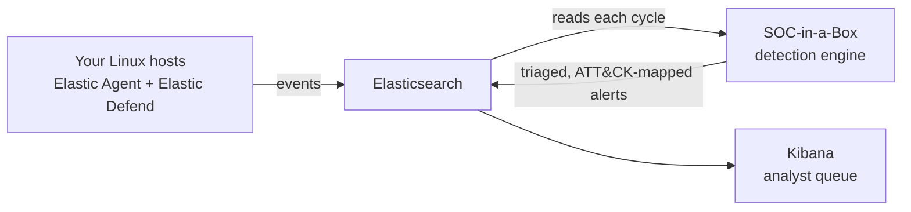

# SOC-in-a-Box

**An open-source, AI-enabled security operations platform for Digital Public Infrastructure, built by the Upanzi Network at CMU-Africa.**

SOC-in-a-Box packages what an organization needs to run a Security Operations
Center into something that can be deployed and adapted quickly. It is aimed at
Digital Public Infrastructure (DPI), Digital Public Goods (DPGs), e-government
platforms, and financial services across African markets, where security teams
are small and most organizations cannot build a SOC from scratch for every system
they run.

- **Runs on modest hardware.** Lightweight, containerized, and resource-efficient
  enough for local CPU infrastructure, so data can stay in-country.
- **AI assists the analyst, it does not replace them.** Machine learning and
  agents handle triage, correlation, and routine maintenance. High-impact actions
  stay behind human approval or dry-run defaults.
- **One core, many plugins.** DPI- and sector-specific telemetry, detection rules,
  dashboards, and playbooks (for example, for MOSIP) plug into the core without
  changing it.
- **A training lab as well as a platform.** The same tools serve as a hands-on
  defensive-security lab for students and SOC analysts.



## What's included

| Component | What it does | |
|---|---|---|
| **Detection engine** | Learns normal behavior per host, user, and process, and turns what does not fit into filtered, enriched, ATT&CK-mapped alerts in Kibana | Core |
| **SIEM Maintenance Agent** | Watches the SOC itself: cluster health, ingestion freshness, a daily Google Chat report, guarded auto-remediation | Optional |
| **Alert Triage Agent** | AI-assisted investigation of Elastic Security alerts with a true/false-positive verdict; web UI, REST API, and MCP server | Optional |
| **Greenbone results push** | Sends Greenbone / OpenVAS vulnerability scan results to Elasticsearch daily, labelled new, fixed or unchanged since the previous scan | Optional |

All of it sits on top of the Elastic Stack (Elasticsearch, Kibana, Fleet, and
Elastic Agent with Elastic Defend).

## Requirements

| | |
|---|---|
| Host | Linux with Python 3.10+, or Docker Compose v2 |
| Elastic Stack | Elasticsearch 8.x with Kibana and Fleet |
| Data | Elastic Agent with **Elastic Defend** and **System** on the Linux hosts you want to watch, and about 7 days of their data |

No cluster yet? See [Step 1 of the installation guide](docs/installation.md#step-1--have-an-elastic-stack-with-endpoint-data).

## Quick start

SOC-in-a-Box installs with one script, `deploy.sh`. Run it on the Linux machine
that will host SOC-in-a-Box. It walks you through the setup:

1. Checks the machine has what it needs (Python 3.10+, or Docker).
2. Asks which optional add-ons you want.
3. Asks for your Elasticsearch address, username and password, and tests the
   connection.
4. Installs the detection engine and your add-ons, and starts them as services
   that keep running in the background.
5. Ends with a summary, including the data sources the engine will read.

```bash
git clone https://github.com/cylab-africa/SOC-in-a-Box-ELK-ML-AgenticAI-.git
cd SOC-in-a-Box-ELK-ML-AgenticAI-
./deploy.sh
```

To see what it would do without changing anything, run `./deploy.sh --dry-run`
first. It is safe to run again later, for example to add an add-on.

**Elasticsearch certificate.** A self-managed Elasticsearch signs its own
certificate, so the script shows the certificate's fingerprint and asks what to
do. Choose **1** to trust it (recommended), or **2** to continue without
checking it (fine for a lab or classroom).

**When it finishes**, you will see:

```
== Done ==
  Detection pipeline:   venv
```

followed by the data sources (index patterns) the engine reads. They match a
standard Elastic Agent install; if your cluster names them differently, edit
them in `.env`.

**Then**, in Kibana, create a data view for `ml-anomalies-custom-*`. Alerts
appear there once the models have trained on your data, which happens
automatically on the first cycle.

Something not right? See [Troubleshooting](docs/troubleshooting.md).

## Documentation

| Guide | What's in it |
|---|---|
| [Installation](docs/installation.md) | Prerequisites, `deploy.sh`, Docker, manual install, running as a service |
| [Configuration](docs/configuration.md) | `.env` settings, index names, false-positive lists |
| [Detection engine](docs/detection-engine.md) | What it detects and how it works |
| [Add-ons](docs/add-ons.md) | SIEM Maintenance Agent and Alert Triage Agent |
| [Troubleshooting](docs/troubleshooting.md) | Common errors and what to do |
| [Architecture](docs/architecture.md) | Pipeline stages and where this sits in a SOC |
| [Technical reference](docs/technical-reference.md) | In-depth reference for the detection engine |
| [Development](docs/development.md) | Project layout, tests, and linting |

## Security

Report vulnerabilities privately as described in [SECURITY.md](SECURITY.md).
Never post credentials, hostnames, or IP addresses from your environment in a
public issue.

## License

Apache License 2.0 — see [LICENSE](LICENSE).

## Acknowledgements

The detection engine, its add-ons, and the documentation this project is built
on were designed and written by Noah Shumba at the Upanzi Network, CMU-Africa.
