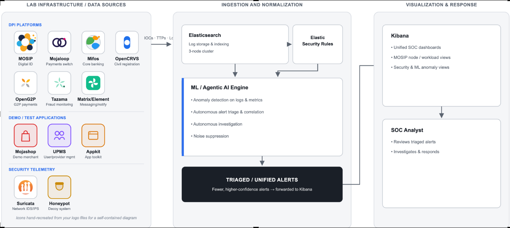

# Linux Security Anomaly Detection

**MITRE ATT&CK-aligned anomaly detection for Linux endpoints, backed by Elasticsearch.**

Detects suspicious process execution, network activity, authentication anomalies, and host behavior using an ensemble of ML models (Isolation Forest, LOF, OCSVM, PCA, AutoEncoder). Enriches alerts with source-event context, classifies false positives, correlates into kill chains, and pushes to Elasticsearch ML anomaly indices for Kibana dashboards.

---

## Features

- **Multi-model ensemble** — Isolation Forest, Local Outlier Factor, One-Class SVM, PCA, AutoEncoder
- **7 data groups** — process, network, user, discovery, metadata, auth, host
- **20 detection jobs** covering MITRE ATT&CK techniques
- **Source-event enrichment** — cross-references raw logs (process, network, auth) for IP/user/command context
- **False-positive classification** — configurable rules with benign-process lists, service accounts, IP reputation
- **Kill-chain correlation** — links anomalies across MITRE ATT&CK stages per entity
- **Adaptive thresholds** — business-hours modifiers, recent-FP dampening, score escalation
- **Pluggable backends** — Elasticsearch (default), file-output (for testing/offline analysis)
- **Configurable everything** — FP lists, thresholds, index patterns via text files and YAML

## Where This Fits: The SOC Platform



This project is the **ML / Agentic AI Engine** in the middle column of the
diagram above. The surrounding platform is a SOC-in-a-Box deployment built
around a digital public infrastructure (DPI) lab, and it works in three stages.

### 1. Lab infrastructure and data sources (left)

Everything that produces telemetry. Three classes of source feed the pipeline:

- **DPI platforms** — MOSIP (digital identity), Mojaloop (payments switch),
  Mifos (core banking), OpenCRVS (civil registration), OpenG2P (government-to-person
  payments), Tazama (fraud monitoring), and Matrix/Element (messaging and
  notification). These are the production-shaped workloads the SOC is defending.
- **Demo / test applications** — Mojashop (demo merchant), UPMS (user and
  provider management), and Appkit (application toolkit). These generate
  realistic user-driven traffic and are also where controlled attack simulations
  are run.
- **Security telemetry** — Suricata (network IDS/IPS) and a honeypot decoy
  system. These contribute signature hits, network flow records, and
  high-confidence attacker interactions.

Each source ships host and application logs, plus IOCs and observed TTPs, into
the ingestion layer.

### 2. Ingestion, normalization, and detection (middle)

- **Elasticsearch** — a 3-node cluster that stores and indexes every log stream.
  It is the single source of truth for the pipeline: this project reads its
  input from ES indices and writes its output back to ES.
- **Elastic Security Rules** — the signature and rule-based detection layer.
  It catches *known* bad behavior — matching IOCs, documented TTPs, and
  established rule logic.
- **ML / Agentic AI Engine (this repository)** — the layer that catches what
  rules cannot: behavior that is *unusual for this environment* rather than
  known-bad in general. It performs anomaly detection over logs and metrics,
  autonomous alert triage and correlation, autonomous investigation of the
  raw events behind each anomaly, and noise suppression.

The two detection layers are complementary. Rules give precision on known
threats; the ML engine gives coverage of novel and living-off-the-land activity.
Both converge on a single output.

- **Triaged / unified alerts** — the engine's deliverable. Instead of forwarding
  every raw model hit, it emits a smaller set of higher-confidence alerts:
  false positives filtered out, related anomalies merged into one narrative, and
  each alert enriched with the context an analyst needs to make a decision.

### 3. Visualization and response (right)

- **Kibana** — unified SOC dashboards, per-node and per-workload views for the
  DPI platforms, and dedicated security and ML anomaly views. Because the engine
  writes back into Elasticsearch ML anomaly indices, its output appears natively
  in Kibana alongside rule-based alerts.
- **SOC analyst** — reviews the triaged alerts, investigates, and responds. The
  entire point of the noise-suppression and correlation stages is to keep this
  queue small enough that a human can work it meaningfully.

## Detection Pipeline


The diagram above is the internal flow of this repository — what actually runs
between "logs land in Elasticsearch" and "an alert reaches Kibana". Each stage
maps to specific modules in the codebase.

**1. Data ingestion** — Data is collected from Elastic indices. Index patterns,
time windows, and query shape are all configuration-driven, so the pipeline can
be pointed at a new environment without code changes.
→ `datamanager.py`, `config/default.yaml`

**2. Data retrieval and preprocessing** — Retrieve, clean, normalize, and enrich
the raw documents. Field names are normalized across log sources, incomplete
records are dropped or defaulted, timestamps are aligned, and entities (host,
user, process, IP) are resolved to a consistent identity so downstream stages
can join on them.
→ `datamanager.py`, `data.py`, `entity_alignment.py`

**3. Feature engineering** — Transform normalized events into the numeric
features the models consume. This is where behavior becomes measurable:
per-entity rarity, command-line characteristics, session and timing patterns,
port and protocol profiles, and volume aggregates over rolling windows.
→ `features/`

**4. Modeling** — Train, validate, version, and load the ML models. The pipeline
runs an ensemble rather than a single detector — Isolation Forest, Local Outlier
Factor, One-Class SVM, PCA, and an AutoEncoder — because each model is sensitive
to a different shape of outlier. Models are trained per data group (process,
network, user, discovery, metadata, auth, host) and persisted with versioning so
scoring is reproducible.
→ `model_manager.py`, `detection_methods.py`, `models/`, `dl_models/`,
`train_models_background.py`

**5. Anomaly detection** — Score live observations against the trained models.
Every model exposes `.decision_function(X)` and every score is normalized to
`[0.0, 1.0]`, so ensemble scores are directly comparable across models and data
groups. Adaptive thresholds then decide what counts as anomalous, adjusting for
business hours, recent false-positive pressure, and score escalation.
→ `anomaly_detector.py`, `adaptive_threshold.py`

Stages 6A, 6B, and 6C run over the resulting anomalies. They are drawn in
parallel because they are independent transformations of the same anomaly set.

**6A. Classification** — Filter and classify anomalies to reduce false
positives. Known infrastructure daemons, non-interactive service accounts,
internal and cloud IP ranges, and expected public ports are all recognized and
either suppressed or down-weighted. The allowlist is graduated rather than
binary: repeat benign behavior is dampened over time instead of being
permanently whitelisted, so a compromised "known good" process can still surface.
→ `push_all_anomalies.py` (filtering), `benign_lists.py`, `config/*.txt`

**6B. Enrichment** — Add context from internal and external sources. Each
anomaly is cross-referenced back against the raw process, network, and
authentication logs that produced it, so the alert carries the actual command
line, source and destination IPs, parent process, and user — not just a score.
This is what makes an alert triageable without pivoting to another tool.
→ `push_all_anomalies.py` (enrichment)

**6C. Threat mapping** — Map each detection to threat frameworks and attach
relevant intelligence. Every detection capability carries at least one MITRE
ATT&CK technique ID (see the coverage table below), which gives analysts a
common vocabulary and lets the correlation stage reason about attack progression.
→ `push_all_anomalies.py` (MITRE enrichment), `config.py`

**7. Correlation and sequencing** — Correlate related anomalies across time and
entities, order them, and build an attack story. Rather than reporting a rare
process, an unusual outbound connection, and an odd sudo call as three separate
alerts, this stage links them per entity across ATT&CK stages and emits one
kill-chain narrative. This is the single biggest reduction in analyst workload.
→ `post_correlation.py`

**8. Output and integration** — Push results back to Elasticsearch or export to
downstream systems for action: ES ML anomaly indices, file and report exports,
APIs and webhooks, Kibana dashboards, and alert notifications. The backend is
pluggable, so a file backend can be used for offline analysis and testing
without an ES cluster.
→ `push_all_anomalies.py`, `backends/`, `alerting/`

### The feedback loops

The two dashed arrows in the diagram matter as much as the forward path:

- **Output back to ingestion** — results written to Elasticsearch become inputs
  on the next cycle. Confirmed detections and analyst dispositions inform benign
  list dampening and threshold adaptation, so the pipeline gets quieter and more
  accurate the longer it runs in a given environment.
- **Threat mapping back to output** — ATT&CK context travels with the alert all
  the way to the destination system, so the technique attribution is present in
  Kibana and in any downstream integration, not just internally during scoring.

## Module Map

```
                    +------------------+
                    |  Data Sources    |
                    |  (ES Indices)    |
                    +--------+---------+
                             |
                    +--------v---------+
                    |  Data Manager    |
                    |  (datamanager.py)|
                    +--------+---------+
                             |
               +-------------+-------------+
               |                           |
    +----------v----------+     +----------v----------+
    |  Feature Extraction |     |  Model Training     |
    |  (features/)        |     |  (model_manager.py) |
    +----------+----------+     +----------+----------+
               |                           |
               +-------------+-------------+
                             |
                    +--------v---------+
                    | Anomaly Detector |
                    | (anomaly_        |
                    |  detector.py)    |
                    +--------+---------+
                             |
          +------------------+------------------+
          |                  |                  |
+---------v------+ +--------v-------+ +--------v--------+
| FP Classifier  | | Source Enrich  | | MITRE Enrichment|
| (push_all_     | | (push_all_     | | (push_all_      |
|  anomalies.py) | |  anomalies.py) | |  anomalies.py)  |
+---------+------+ +--------+-------+ +--------+--------+
          |                  |                  |
          +------------------+------------------+
                             |
                    +--------v---------+
                    | Kill-Chain       |
                    | Correlation      |
                    | (post_           |
                    |  correlation.py) |
                    +--------+---------+
                             |
                    +--------v---------+
                    | Backend Push     |
                    | (ES / File)      |
                    +------------------+
```

## Quickstart

### 1. Clone and install

```bash
git clone https://github.com/cylab-africa/SOC-in-a-Box-ELK-ML-AgenticAI-.git
cd SOC-in-a-Box-ELK-ML-AgenticAI-
pip install -e ".[dev]"
```

### 2. Configure

```bash
cp .env.example .env
# Edit .env with your Elasticsearch credentials and settings
```

### 3. Train models

```bash
python train_models_background.py
```

### 4. Run detection

```bash
# One-shot detection
python main.py

# Continuous service
python realtime_service.py

# Push anomalies to ES ML indices
python push_all_anomalies.py
```

### 5. Docker (optional)

```bash
docker compose --env-file .env -f docker/docker-compose.yml up
```

See [DEPLOYMENT.md](DEPLOYMENT.md#5-docker-deployment) for what the bundled services do and how to point at an existing production cluster instead.

## Configuration

For a full walkthrough of every file you need to edit when deploying
against your own environment — required vs. optional, exact format, and
what to put in each (including the IP-range/hostname allowlists below) —
see [DEPLOYMENT.md](DEPLOYMENT.md).

### Environment Variables

See [.env.example](.env.example) for all available settings. Key variables:

| Variable | Description | Required |
|----------|-------------|----------|
| `ES_HOST` | Elasticsearch URL | Yes |
| `ES_USERNAME` | ES username | Yes |
| `ES_PASSWORD` | ES password | Yes |
| `DAGSHUB_TOKEN` | MLflow tracking token | No |

### FP Classification Lists

Edit files in `config/` to customize false-positive filtering for your environment:

| File | Purpose |
|------|---------|
| `config/benign_processes.txt` | Infrastructure daemons (kubelet, sshd, etc.) |
| `config/service_accounts.txt` | Non-interactive accounts (www-data, etc.) |
| `config/infrastructure_hosts.txt` | Known infra hostnames |
| `config/public_facing_hosts.txt` | Internet-facing hosts |
| `config/internal_ip_prefixes.txt` | Private IP ranges |
| `config/cloud_ip_prefixes.txt` | Cloud/CDN provider IPs |
| `config/public_service_ports.txt` | Expected public ports |

### Reference Configuration

See [config/default.yaml](config/default.yaml) for all detection thresholds, ML parameters, and correlation settings.

## MITRE ATT&CK Coverage

| Technique | ID | Detection Job |
|-----------|----|---------------|
| Command and Scripting Interpreter | T1059 | rare_process_on_host, suspicious_cmd_chains |
| Valid Accounts | T1078 | rare_user_activity, anomalous_login_times |
| Abuse Elevation Control | T1548 | rare_sudo_usage |
| Network Service Scanning | T1046 | host_discovery_patterns |
| Application Layer Protocol | T1071 | unusual_connections |
| Non-Standard Port | T1571 | anomalous_ports |
| Ingress Tool Transfer | T1105 | (suspicious command regex) |
| Brute Force | T1110 | brute_force_detection |
| Masquerading | T1036 | rare_process_host_combo, rare_metadata_process |
| DNS over Application Layer | T1071.004 | rare_dns_queries |
| Protocol Tunneling | T1572 | unusual_connections |

## Project Structure

```
linux-anomaly-detection/
├── anomaly_detector.py     # Core detection engine
├── config.py               # Dataclass-based configuration
├── datamanager.py          # Elasticsearch data fetching
├── detection_methods.py    # ML model implementations
├── main.py                 # One-shot detection CLI
├── model_manager.py        # Model training/loading/versioning
├── push_all_anomalies.py   # FP classification, enrichment, push
├── post_correlation.py     # Kill-chain correlation
├── realtime_service.py     # Continuous detection service
├── train_models_background.py  # Background training with checkpoints
├── benign_lists.py         # Graduated allowlist with dampening
├── backends/               # Pluggable SIEM backends
│   ├── base.py             # Abstract interface
│   ├── elasticsearch_backend.py
│   └── file_backend.py
├── features/               # Modular feature extractors
├── models/                 # ML model wrappers (PyOD, ensemble)
├── dl_models/              # Deep learning models (AutoEncoder)
├── adversarial/            # Robustness / evasion testing
├── config/                 # FP lists and reference configuration
├── docker/                 # Dockerfile and docker-compose
├── docs/                   # Reproduction guides, diagrams, supplementary docs
│   └── images/             # Architecture and pipeline diagrams
├── tests/                  # Pytest test suite
├── validation/             # Quality gate scripts per agent
└── benchmarks/             # Performance benchmarking
```

## Development

```bash
# Install with dev dependencies
pip install -e ".[dev]"

# Run tests
pytest tests/ -x --tb=short

# Lint
ruff check .

# Type check
mypy --ignore-missing-imports *.py
```

## Contributing

See [CONTRIBUTING.md](CONTRIBUTING.md) for guidelines.

## License

Apache License 2.0 — see [LICENSE](LICENSE).
