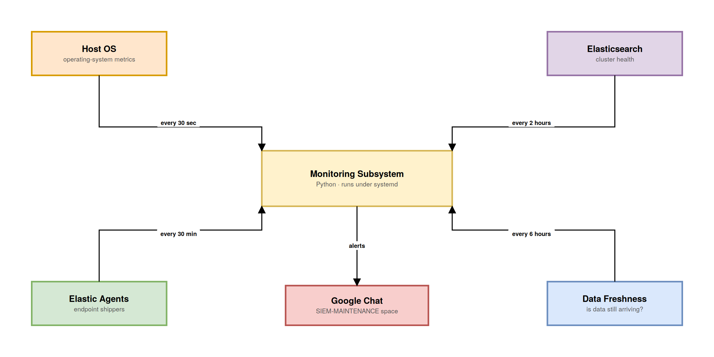
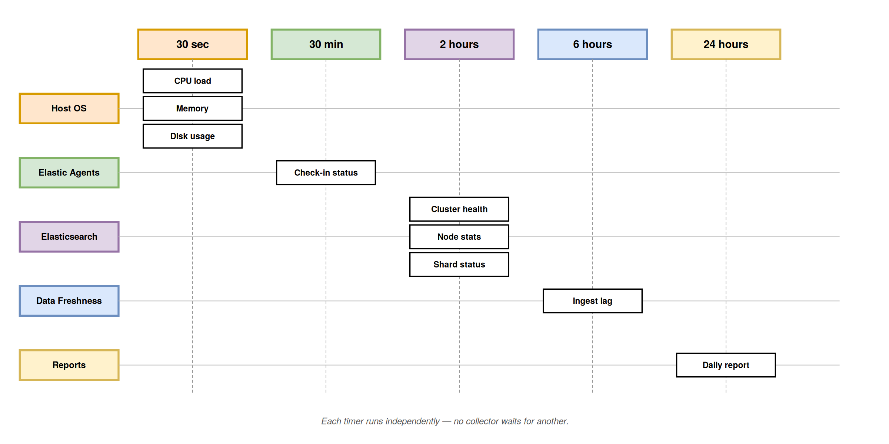
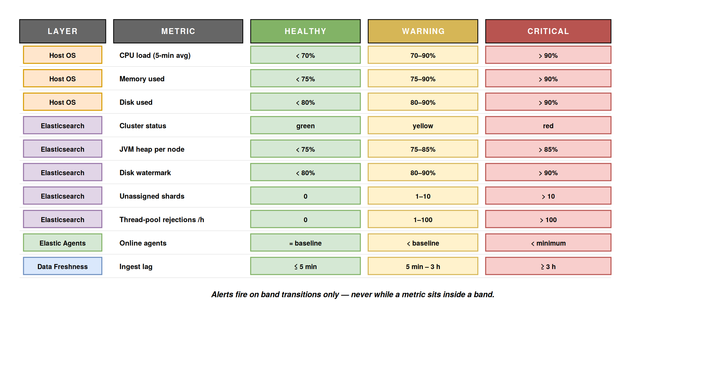
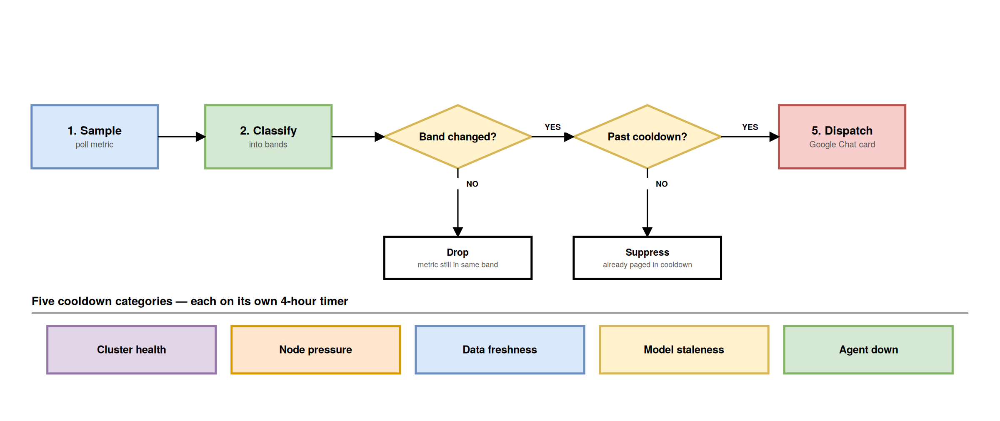
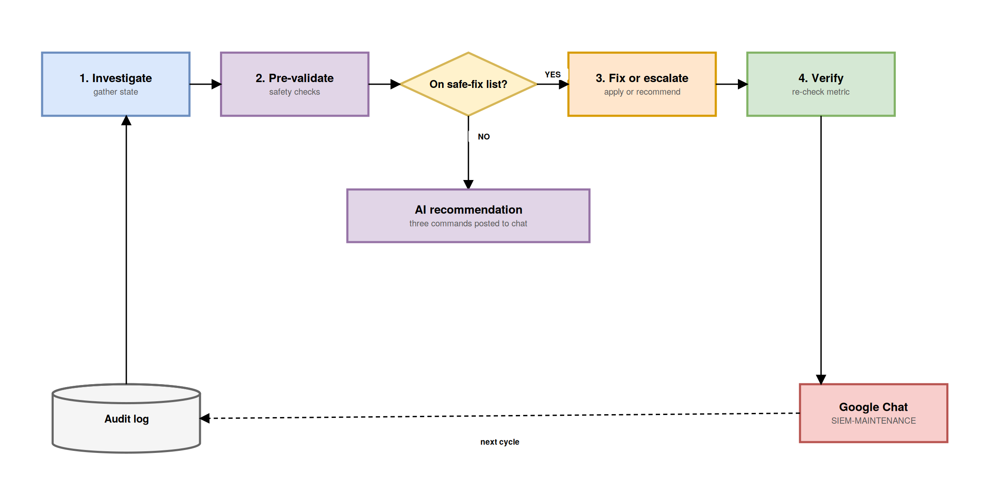

# SIEM Maintenance Agent — Your Infrastructure's 24/7 Watchdog

**An intelligent agent that monitors your Elasticsearch security infrastructure around the clock, alerts your team on Google Chat when something goes wrong, and can even fix common problems automatically.**

Think of it as a tireless teammate that watches your SIEM cluster health, checks if your security agents are still sending data, sends you a daily status report every morning, and takes care of routine maintenance tasks — so your team can focus on real threats instead of infrastructure babysitting.

This repository runs **Elasticsearch + ingestion health checks**, **scheduled Google Chat** updates for your maintenance space, and optional **AI-powered** analysis (OpenAI, Anthropic Claude, or local Ollama models). Configuration is via **`.env`** at the repo root (copied into **`Agent-SIEM-maintenance/`** by the installer).

| | |
|--|--|
| **License** | [Apache-2.0](LICENSE) |
| **Version** | May 2026 |
| **Scope** | Infrastructure monitoring — cluster health, freshness, reporting, optional remediation. |
| **Spec ↔ code** | [docs/00-design-spec-vs-this-repo.md](docs/00-design-spec-vs-this-repo.md) |

**Designed by Noah Shumba** ([nshumba@andrew.cmu.edu](mailto:nshumba@andrew.cmu.edu)), CMU-Africa Upanzi Network.

---

## Quick start

**One command (prompts for everything, then checks APScheduler is available and can start the scheduler):**

**Windows (PowerShell):**

```powershell
cd C:\path\to\Siem-Maintenance
powershell -ExecutionPolicy Bypass -File .\run-all.ps1
```

**Linux / macOS:**

```bash
cd /path/to/Siem-Maintenance
bash run-all.sh
```

That script will ask whether to run **`install.ps1` / `install.sh`**, runs **`verify_setup.py`**, imports **`maintenance_service`** and **`apscheduler`** to confirm the **onsite scheduler** stack is present, then asks whether to start **`maintenance_service.py`** in the foreground (daily report + health polls).

**Manual path (recommended for production):** run **`install.ps1`** or **`install.sh`** once. On **Linux with systemd**, the installer offers **`siem-maintenance.service`** (survives reboot). Otherwise it can start the scheduler in the **background**, or use **foreground** commands in [Run](#run).

Prerequisite: **Python 3.10+**. On **Debian/Ubuntu**, install a venv-capable Python **before** `install.sh`:

```bash
sudo apt update && sudo apt install -y python3-venv
```

---

## What’s in this repository

**`Agent-SIEM-maintenance/`** — six modules + tests:

| Module | Role |
|--------|------|
| [`maintenance_service.py`](Agent-SIEM-maintenance/maintenance_service.py) | Scheduler: morning report + periodic `es_health_monitor` + auto-remediation every 12 h. |
| [`ultra_siem_monitor.py`](Agent-SIEM-maintenance/ultra_siem_monitor.py) | Daily report CLI → `enhanced_health_monitor`. |
| [`enhanced_health_monitor.py`](Agent-SIEM-maintenance/enhanced_health_monitor.py) | Cluster / ingestion snapshot, LLM text, structured **Daily SIEM Report** Chat message + Elastic-log follow-up. |
| [`siem_daily_report.py`](Agent-SIEM-maintenance/siem_daily_report.py) | Report layout (root-cause sections: allocation explain, disk %, pending tasks, freshness, factual obs), Kibana detection-rule summary, ES log excerpt builder. |
| [`es_health_monitor.py`](Agent-SIEM-maintenance/es_health_monitor.py) | Health, shards, freshness, Chat alerts (cooldown). |
| [`auto_remediate.py`](Agent-SIEM-maintenance/auto_remediate.py) | Investigate + 13 safe auto-fixes (scheduled every 12 h by default; manual via `--auto-fix`). |
| [`tests/`](Agent-SIEM-maintenance/tests/) | Offline unit tests for formatter, log excerpt, LLM failure classification (no live ES needed). |

**LLM routing:** model ids starting with **`gpt-`** use **OpenAI** (`OPENAI_API_KEY`), ids starting with **`claude-`** use **Anthropic** (`ANTHROPIC_API_KEY`), and any other **`LLM_MODEL`** uses **Ollama** at **`OLLAMA_URL`**. Set **`LLM_ENABLED=false`** to turn off AI text while keeping metrics and Chat.

Design detail: [docs/04](docs/04-remediation-loop.md), [docs/08](docs/08-agentic-behaviors.md).

---

## Install

**Windows**

```powershell
cd C:\path\to\Siem-Maintenance
powershell -ExecutionPolicy Bypass -File .\install.ps1
```

**Linux / macOS**

```bash
cd /path/to/Siem-Maintenance
bash install.sh
```

The installer **writes `.env`**, copies it to **`Agent-SIEM-maintenance/.env`**, installs **`requirements.txt`**, runs optional checks, and can **start the live scheduler** for you.

### What you need before running the installer

| Item | Why |
|------|-----|
| **Python 3.10+** on `PATH` (`python` on Windows, `python3` on Linux) | Venv and packages. On Debian/Ubuntu you may need `python3-venv`. |
| **Elasticsearch** URL and credentials | Health checks and daily report query cluster and index patterns. |
| **Google Chat** incoming webhook URL (`GC_ALERT_WEBHOOK`) | Cards go to your maintenance space. |
| **LLM (optional)** | OpenAI API key if `LLM_MODEL` starts with `gpt-`; Anthropic API key if it starts with `claude-`; or **Ollama** reachable at `OLLAMA_URL` for any other model name. If LLM is missing or fails, **metrics and Chat still run**; AI narrative is skipped with a warning. |

### How to get a Google Chat webhook

The installer asks for a **Google Chat incoming webhook URL**. Create one before running `install.sh`:

1. Open **Google Chat** in a browser (chat.google.com) or the desktop app.
2. Open or create the **Space** where you want SIEM alerts to appear (e.g. `SIEM-MAINTENANCE`).
3. Click the **space name** at the top to open settings, then choose **Integrations** (or **Apps & integrations** depending on your Workspace edition).
4. Click **Add webhooks** (or **Manage webhooks**).
5. Give the webhook a name (e.g. `SIEM Maintenance Bot`) and optionally paste an avatar URL.
6. Click **Save** and copy the webhook URL -- it looks like:
   ```
   https://chat.googleapis.com/v1/spaces/AAAA.../messages?key=...&token=...
   ```
7. Paste this URL when the installer asks for `GC_ALERT_WEBHOOK`.

> **Workspace Admin note:** If you don't see the webhooks option, your Google Workspace admin may need to enable **Incoming Webhooks** for your organization under **Google Workspace Admin Console > Apps > Google Chat > Manage Webhooks**.

> **Optional logo:** The installer also asks for `GC_CARD_LOGO_URL` -- an image URL displayed in every card header. Use any publicly accessible image (the default uses the Elastic GitHub avatar). Leave blank to send cards without a logo.

### What the installer does (step by step)

1. **Creates or reuses `.venv`** (unless you decline) and upgrades `pip`. On **Debian/Ubuntu**, if `ensurepip` is missing, the script runs **`sudo apt-get install`** for **`pythonX.Y-venv`** / **`python3-venv`** (sudo password), then continues.
2. **Prompts for Elasticsearch** (`ES_HOST`, `ES_USERNAME`, `ES_PASSWORD`, `KIBANA_HOST`).
3. **Prompts for Google Chat** (`GC_ALERT_WEBHOOK`, `GC_ALERT_SPACE_NAME`).
4. **Prompts for LLM mode:** OpenAI, Ollama, Anthropic Claude, or off (`LLM_ENABLED=false`).
   - **Ollama path:** shows **this machine’s RAM/CPU/GPU** and suggested tags via **`ollama_preflight.py recommend`**, then your model choice. After `pip install`, it can run **`ollama_preflight.py ensure`** to hit `/api/tags` and run **`ollama pull`** if the CLI is installed; if the CLI or server is missing, you get a yellow message and the **scheduler still works** without AI text.
5. **Prompts for scheduler defaults** (timezone, `DAILY_REPORT_TIME_CAT`, poll interval, cooldown, index patterns).
6. **Writes `.env`** at the repo root and copies it to **`Agent-SIEM-maintenance/.env`**.
7. **Runs `verify_setup.py`** if you accept (imports, optional live ES / Ollama checks).
8. **Linux + systemd:** asks to install **`siem-maintenance.service`** (default **Y**) via **`deploy/install-systemd-service.sh`** so the scheduler **survives reboot** and **restarts on failure** (`sudo` required). If that succeeds, **no** duplicate `nohup` process is started.
9. **Otherwise (Windows, macOS, or if you decline systemd):** offers to start the scheduler in the **background** (default **Y**):
   - **Windows:** `maintenance_service.py` via **`Start-Process`** (hidden window), logs under **`logs/maintenance_service.log`** and **`logs/maintenance_service.errors.log`**, PID in **`logs/maintenance_service.pid`**.
   - **Linux / macOS (no systemd unit):** `nohup … >> logs/maintenance_service.log 2>&1 &`, same PID file.
   - If a previous PID in that file is still running, you are asked before starting a **second** copy (duplicate alerts).

### Persistent service (survives reboot)

**Linux (systemd)** — recommended for servers.

| Method | What to do |
|--------|------------|
| **Automated** | Run **`install.sh`**, accept **“Install systemd service…”** (default Y), enter **`sudo`** when prompted. |
| **Manual** | From the repo: `sudo bash deploy/install-systemd-service.sh "$(pwd)" "$(pwd)/.venv/bin/python"` (adjust paths). With no venv: pass your `python3` path as the second argument. |

The unit file is **`/etc/systemd/system/siem-maintenance.service`**. The service uses **`WorkingDirectory=.../Agent-SIEM-maintenance`** and **`python-dotenv`** in **`maintenance_service.py`** to load the repo **`.env`** and **`Agent-SIEM-maintenance/.env`**.

Useful commands:

```bash
sudo systemctl status siem-maintenance.service
journalctl -u siem-maintenance.service -f
sudo systemctl restart siem-maintenance.service
sudo systemctl disable --now siem-maintenance.service   # stop and disable on boot
```

If you install the unit **after** editing **`.env`**, run **`sudo systemctl restart siem-maintenance.service`** so the process reloads configuration (Python re-reads `.env` on the **next** scheduler tick / restart).

**Windows** — there is no systemd. Use **Task Scheduler** (or a Windows Service wrapper):

1. Create a task that runs at startup / when the user logs on (or as **SYSTEM** if paths and secrets are accessible).
2. **Action:** **Start a program**  
   - **Program:** `C:\path\to\Siem-Maintenance\.venv\Scripts\python.exe`  
   - **Arguments:** `C:\path\to\Siem-Maintenance\Agent-SIEM-maintenance\maintenance_service.py`  
   - **Start in:** `C:\path\to\Siem-Maintenance\Agent-SIEM-maintenance`
3. Ensure **`.env`** exists at the repo root and under **`Agent-SIEM-maintenance\`**.

### After install: when do alerts and reports arrive?

| Job | Driven by | First run |
|-----|-----------|-----------|
| **Morning / daily report** | `DAILY_REPORT_TIME_CAT` + `MAINTENANCE_IANA_TIMEZONE` in `.env` | Next occurrence of that clock time (APScheduler cron). |
| **Periodic ES health poll** | `ES_HEALTH_MONITOR_INTERVAL_SECONDS` (or `SIEM_HEALTH_POLL_INTERVAL_SECONDS`) | First run after **one full interval** from process start (then repeats). Not all polls send Chat; **`es_health_monitor.py`** applies thresholds and **`ES_ALERT_COOLDOWN_HOURS`**. |
| **Auto-remediation pass** | `AUTO_REMEDIATION_INTERVAL_HOURS` (default **12**, set `0` to disable) | First run after one full interval from process start. Runs `auto_remediate.py --auto-fix` with safe per-action cooldowns; set `AUTO_REMEDIATION_DRY_RUN=true` to schedule in dry-run mode. |

So finishing the script does **not** guarantee an immediate Chat message; you get **ongoing** behavior according to those timers and cluster conditions.

### Logs and stopping the scheduler

**If you use systemd (Linux):** logs go to the journal (**`journalctl -u siem-maintenance.service`**). Stop/disable with **`systemctl`** (see [Persistent service](#persistent-service-survives-reboot)).

**If you use the installer background process (nohup / Windows `Start-Process`):**

- **Logs:** `logs/maintenance_service.log` (and on Windows, `logs/maintenance_service.errors.log`).
- **Stop (Windows, PID file):** `Stop-Process -Id <pid> -Force` where `<pid>` is in `logs/maintenance_service.pid`.
- **Stop (Linux nohup):** `kill $(cat logs/maintenance_service.pid)` (or the PID printed at install time).

**Measured in code (via Elasticsearch):** cluster health, per-node JVM heap / disk / CPU, index thread-pool rejections, API timing thresholds, ingestion freshness on three index patterns from `.env`. There is **no** host **`psutil`** probe in this tree — see [docs/00](docs/00-design-spec-vs-this-repo.md). TLS to Elasticsearch is not fully prompted in install; adjust **`connect_es_from_env`** in `es_health_monitor.py` if you need custom CAs.

### Key `.env` variables (installer writes most of these)

| Variable | Role |
|----------|------|
| `ES_HOST`, `ES_USERNAME`, `ES_PASSWORD` | Cluster access |
| `GC_ALERT_WEBHOOK`, `GC_ALERT_SPACE_NAME` | Chat delivery (see [How to get a Google Chat webhook](#how-to-get-a-google-chat-webhook)) |
| `GC_CARD_LOGO_URL` | Image URL shown in every card header (daily report, health alerts, remediation) |
| `LLM_ENABLED`, `LLM_MODEL`, `ES_HEALTH_LLM_MODEL`, `OPENAI_API_KEY`, `ANTHROPIC_API_KEY`, `OLLAMA_URL` | Optional AI narrative (OpenAI, Anthropic, or Ollama) |
| `MAINTENANCE_IANA_TIMEZONE`, `DAILY_REPORT_TIME_CAT` | Daily report wall clock |
| `ES_HEALTH_MONITOR_INTERVAL_SECONDS`, `ES_ALERT_COOLDOWN_HOURS` | Poll cadence and alert spacing |
| `ES_PROCESS_INDEX`, `ES_NETWORK_INDEX`, `ES_DISCOVERY_INDEX` | Index patterns for freshness / investigation |
| `KIBANA_HOST` | Base URL for Kibana (used for detection-rule status in the **daily SIEM report**). Same auth as `ES_USERNAME` / `ES_PASSWORD`. |
| `DAILY_REPORT_GREETING` | Opening line in Chat (default: `Good morning team!`). |
| `ES_LOG_INDEX_PATTERNS` | Comma-separated index patterns the log excerpt searches; default covers `.ds-elastic-cloud-logs-*`, `.monitoring-es-*`, `logs-elasticsearch.*`, `logs-elastic_agent*`. |
| `DAILY_REPORT_RULE_SAMPLES_*` | Optional limits for failed/partial/never-executed rule examples (`FAILED`, `PARTIAL`, `NEVER`; defaults 12 / 8 / 4). |
| `OLLAMA_TIMEOUT_SECONDS`, `OLLAMA_NUM_CTX` | Ollama generate timeout (default 180 s) and context window (default 8192). Raise `NUM_CTX` if the daily prompt is empty-completing on small models. |
| `AUTO_REMEDIATION_INTERVAL_HOURS`, `AUTO_REMEDIATION_DRY_RUN` | Cadence (default 12; `0` disables) and dry-run toggle for the scheduled `auto_remediate --auto-fix` pass. |
| `MAX_FORCE_MERGE_PER_RUN` | Cap on how many over-sharded indices `auto_remediate` will force-merge per pass (default 2). |
| `SNAPSHOT_RETENTION_DAYS` | Auto-remediation deletes completed snapshots older than this (default 30). |
| `EMPTY_INDEX_RETENTION_DAYS` | Auto-remediation deletes 0-doc indices older than this (default 90). |
| `MAX_EMPTY_INDEX_DELETE_PER_RUN` | Cap on empty-index deletions per pass (default 20). |
| `DAILY_REPORT_ATTACH_ES_LOGS` | If `true`, sends a follow-up Chat message with last 24 h WARN/ERROR Elastic log lines (default `false`). |
| `DAILY_REPORT_ATTACH_ES_JSON` | If `true`, sends the legacy JSON cluster-health excerpt (default `false`). |

---

## Verify (after install)

From the **repository root**, using the same interpreter as the venv:

```powershell
.\.venv\Scripts\python.exe .\verify_setup.py
```

```bash
source .venv/bin/activate
python verify_setup.py
```

Use **`--skip-network`** to only check `.env` and imports (no live ES or Ollama calls).

If you use a **non-`gpt-` model** but **Ollama is not running** yet (e.g. still on `localhost:11434`), verification **warns** and still exits **0**. Use **`--strict-ollama`** if the check should **fail** when Ollama is unreachable.

**Ollama helpers** (repo root): **`python ollama_preflight.py recommend`** prints approximate RAM, CPU, optional NVIDIA GPU, and suggested model tags. **`python ollama_preflight.py ensure --url <OLLAMA_URL> --model <tag>`** checks **`/api/tags`** and runs **`ollama pull`** if the model is missing (the CLI uses **`OLLAMA_HOST`** derived from `--url`). During verification, **`--pull-missing-ollama`** does the same ensure step automatically.

---

## Run

If you installed **systemd** on Linux (**`siem-maintenance.service`**), the scheduler is already running at boot; use **`journalctl`** (see [Install](#install)). If you started it from **`install.ps1` / `install.sh`** without systemd, leave that process running (see **Logs and stopping** under [Install](#install)). Otherwise start it manually below.

**Scheduler (foreground)** — same behavior as background; logs go to the terminal.

```powershell
cd C:\path\to\Siem-Maintenance
.\.venv\Scripts\python.exe .\Agent-SIEM-maintenance\maintenance_service.py
```

```bash
cd /path/to/Siem-Maintenance
source .venv/bin/activate
python Agent-SIEM-maintenance/maintenance_service.py
```

`maintenance_service` loads **repo** `.env` then **`Agent-SIEM-maintenance/.env`** (see `load_env` in the script). The commands above work when run from the **repository root**.

**One-shot** (no scheduler; useful for testing)

```powershell
.\.venv\Scripts\python.exe .\Agent-SIEM-maintenance\maintenance_service.py --once-daily
.\.venv\Scripts\python.exe .\Agent-SIEM-maintenance\maintenance_service.py --once-poll
.\.venv\Scripts\python.exe .\Agent-SIEM-maintenance\maintenance_service.py --once-remediate
```

**Offline tests** (no live ES / Ollama / Chat needed):

```bash
python Agent-SIEM-maintenance/tests/test_daily_report_and_llm.py
```

For production, prefer **systemd** on Linux (this repo’s **`deploy/install-systemd-service.sh`**), **Task Scheduler** on Windows, or a **Windows service**; see [Persistent service](#persistent-service-survives-reboot) and [docs/09](docs/09-deployment.md).

---

## Auto-remediation

`auto_remediate.py` runs on a 12-hour schedule (configurable via `AUTO_REMEDIATION_INTERVAL_HOURS`) and applies **13 safe, reversible fixes**. Every action has pre-validation checks, cooldown timers to prevent repeated application, and sends a Google Chat notification with the result.

| # | Fix name | What it does | Trigger |
|---|----------|-------------|---------|
| 1 | `scroll-contexts` | Clears abandoned scroll contexts | >80% of limit or >50 total |
| 2 | `unassigned-shards` | Retries failed shard allocation | Any unassigned shards |
| 3 | `thread-pools` | Increases search/write queue sizes (transient) | >100 search or >50 write rejections |
| 4 | `fielddata` | Clears fielddata cache | >100 MB total fielddata |
| 5 | `caches` | Clears request + query caches | Any node heap >=80% |
| 6 | `ilm` | Restarts ILM and retries errored indices | ILM stopped or indices in ERROR step |
| 7 | `force-merge` | Merges over-sharded read-only indices | >50 segments/primary, >=1 GB, non-essential |
| 8 | `cleanup` | Deletes old ML result files | Files older than `ML_FILE_RETENTION_DAYS` |
| 9 | `transforms` | Restarts failed/stopped transforms | Any transform in failed/stopped state |
| 10 | `snapshots` | Deletes old completed snapshots | Snapshots older than `SNAPSHOT_RETENTION_DAYS` (default 30) |
| 11 | `empty-indices` | Deletes old indices with 0 documents | >90 days old, 0 docs, non-essential |
| 12 | `watermark-reset` | Clears read-only blocks after disk recovery | `read_only_allow_delete` set AND disk <90% |
| 13 | `watchers` | Restarts stopped Watcher service | Watcher in stopped/stopping state |

**Protections:** Essential indices (`.ds-logs-endpoint.events.*`, `.internal.alerts-*`) are never deleted or modified. All actions are logged to `results/auto_remediation_log.jsonl`.

```bash
# Run all remediations
python3 auto_remediate.py --auto-fix

# Dry run (no changes, shows what would happen)
python3 auto_remediate.py --auto-fix --dry-run

# Investigation only (diagnostics, no fixes)
python3 auto_remediate.py --investigate-only

# Run a single fix
python3 auto_remediate.py --fix watermark-reset
```

---

## Closed-Loop Feedback System

The agent learns from operator feedback. Every alert card sent to Google Chat includes three buttons (**Helpful** / **Not Helpful** / **Incorrect**); each click triggers an LLM "judge" that decides whether to add, confirm, or reject a rule in the persistent memory file `Agent-SIEM-maintenance/SYSTEM_MEMORY.md`. That memory is injected into the LLM system prompt for the next alert cycle, so the agent gets better over time.

### Flow

```
Alert sent           User clicks button         Apps Script              Sheet              Poller                  System memory
(Chat API,    ---->  (Google Chat)        ---->  feedback_response  ----> append row ---->  judge LLM verdict ---->  SYSTEM_MEMORY.md
 app-mode)                                       writes Sheet row                            (add/confirm/reject)    (active rules,
                                                                                                                      pending hypotheses,
                                                                                                                      rejected patterns)
                                                                                                                              |
                                                                                                                              v
                                                                                                                     next alert prompt
                                                                                                                     includes learned rules
```

### One-time setup

This walks through everything we set up to make the feedback loop work end to end.

#### 1. Service account for sending alert cards as the bot

Webhook-sent cards are owned by "Webhook Bot" and can't receive button clicks. A registered Chat App must send them.

```bash
gcloud iam service-accounts create siem-chat-bot \
  --display-name="SIEM Maintenance Bot" \
  --project=<YOUR_PROJECT_ID>

gcloud iam service-accounts keys create Agent-SIEM-maintenance/siem-chat-bot-key.json \
  --iam-account=siem-chat-bot@<YOUR_PROJECT_ID>.iam.gserviceaccount.com
```

Save the key path in `.env` as `GOOGLE_CHAT_SA_KEY`.

#### 2. Enable required Google APIs

```bash
gcloud services enable \
  chat.googleapis.com \
  sheets.googleapis.com \
  script.googleapis.com \
  --project=<YOUR_PROJECT_ID>
```

#### 3. Create the feedback Google Sheet

1. Create a new Google Sheet, name it `SIEM Feedback`
2. Share it with the service account email (`siem-chat-bot@<PROJECT>.iam.gserviceaccount.com`) as **Editor**
3. Copy the Sheet ID from the URL (between `/d/` and `/edit`)
4. Add to `.env`: `FEEDBACK_SHEET_ID=<sheet_id>`

#### 4. Create the Apps Script (handles button clicks)

1. In the Sheet, click **Extensions > Apps Script**
2. Replace default code with the content of `Agent-SIEM-maintenance/deploy/Code.gs`
3. Save (Ctrl+S)
4. Click the gear icon (Project Settings) > Change project > enter your GCP project number
5. **Deploy > New deployment > Type: Google Workspace Add-on > Deploy**
6. Copy the **Head deployment ID**
7. Visit `https://script.google.com/home/usersettings` and toggle **Google Apps Script API** to ON

#### 5. Register the Chat App in Google Cloud Console

Open `https://console.cloud.google.com/apis/api/chat.googleapis.com/hangouts-chat?project=<YOUR_PROJECT_ID>` and configure:

| Field | Value |
|-------|-------|
| App name | `SIEM Maintenance Bot` |
| Avatar URL | (optional logo URL) |
| Description | `Receives feedback on SIEM alerts` (max 40 chars) |
| Functionality | Check both: direct messages, join spaces |
| Connection | **Apps Script** |
| Deployment ID | (the Head deployment ID from step 4) |
| Visibility | Specific people: `<your-email>` |

Click **Save** at the bottom.

#### 6. Add the bot to your Chat space

In Google Chat: open the space (e.g., `SIEM-Maintenance-Alerts`) > click the space name > **Apps & integrations** > **Add apps** > search for **SIEM Maintenance Bot** > **Add**.

#### 7. Get the space ID

```bash
python3 -c "
from google.oauth2 import service_account
from googleapiclient.discovery import build
creds = service_account.Credentials.from_service_account_file('Agent-SIEM-maintenance/siem-chat-bot-key.json', scopes=['https://www.googleapis.com/auth/chat.bot'])
svc = build('chat', 'v1', credentials=creds)
for s in svc.spaces().list().execute().get('spaces', []):
    print(s['name'], s.get('displayName'))
"
```

Add to `.env`: `GOOGLE_CHAT_SPACE_ID=spaces/XXXXXXXX`

#### 8. Configure feedback env vars

```bash
# .env additions
GOOGLE_CHAT_SA_KEY=/abs/path/to/Agent-SIEM-maintenance/siem-chat-bot-key.json
GOOGLE_CHAT_SPACE_ID=spaces/AAQAHZb5nzw
GOOGLE_CHAT_VERIFICATION_TOKEN=<token from Chat API config>
FEEDBACK_SHEET_ID=1uOqnq1HYOocLlqcZdJAJrZUWYIbPHuPasKVp0d4tXgM
FEEDBACK_SERVER_PORT=8090
FEEDBACK_PROMOTION_THRESHOLD=2
FEEDBACK_CONTEXT_TTL_HOURS=72
```

### Running the feedback loop

Once configured, the alert flow is automatic:

```bash
# Alerts include feedback buttons when GOOGLE_CHAT_SA_KEY is set
cd Agent-SIEM-maintenance
python3 es_health_monitor.py
```

To process queued feedback (reads pending rows from the Sheet, runs the judge, updates `SYSTEM_MEMORY.md`):

```bash
# One-shot
python3 feedback_poller.py

# Continuous (every 60 seconds)
python3 feedback_poller.py --loop 60
```

### What the system learns

`SYSTEM_MEMORY.md` accumulates three categories of operator wisdom:

| Section | Content | Used in prompt as |
|---------|---------|-------------------|
| **Active Rules** | Confirmed patterns (≥2 feedback events) | Positive constraints injected as "Apply these learned rules" |
| **Pending Hypotheses** | Single-feedback rules awaiting confirmation | (not injected until promoted) |
| **Rejected Patterns** | Contradicted patterns | Negative constraints injected as "Do NOT follow these patterns" |

Promotion threshold defaults to 2 and is configurable via `FEEDBACK_PROMOTION_THRESHOLD`.

### Verifying it works

```bash
# Run the full feedback test suite
cd Agent-SIEM-maintenance
python3 -m pytest tests/test_system_memory.py tests/test_feedback_judge.py \
                  tests/test_feedback_server.py tests/test_feedback_e2e.py -v
```

All 63 feedback-related tests should pass (system memory, judge, HTTP server, and 4 end-to-end scenarios).

### Files

| File | Purpose |
|------|---------|
| `Agent-SIEM-maintenance/llm_common.py` | Shared LLM routing (OpenAI / Anthropic / Ollama) |
| `Agent-SIEM-maintenance/system_memory.py` | `SYSTEM_MEMORY.md` reader/writer with atomic writes + file locking |
| `Agent-SIEM-maintenance/alert_context.py` | Persists alert metadata for feedback correlation |
| `Agent-SIEM-maintenance/feedback_judge.py` | LLM judge — decides add/confirm/reject from feedback |
| `Agent-SIEM-maintenance/feedback_server.py` | Flask endpoint (fallback for direct HTTP integrations) |
| `Agent-SIEM-maintenance/feedback_poller.py` | Reads pending Sheet rows, runs judge, updates memory |
| `Agent-SIEM-maintenance/deploy/Code.gs` | Apps Script that runs in Google's cloud, writes to Sheet |
| `Agent-SIEM-maintenance/SYSTEM_MEMORY.md` | Persistent learned rules (read at every alert generation) |
| `deploy/siem-feedback.service` | systemd unit for the HTTP feedback server (optional) |

---

## Architecture figures

Diagrams in [`docs/figures/`](docs/figures/) illustrate the **target** multi-probe design. This Git repo runs **two** scheduled jobs by default (daily report + health poll); see [docs/00](docs/00-design-spec-vs-this-repo.md) and [docs/01](docs/01-what-is-watched.md)–[docs/02](docs/02-cadence.md).

### Figure 1 — Hub architecture

The maintenance layer sits between **four data surfaces** (host, Elasticsearch, agents, ingestion freshness) and **Google Chat**. Samples are normalized, thresholds and cooldowns applied, then **actionable cards** are sent.



### Figure 2 — Monitoring schedule

Collectors use **different timers** so fast failures (e.g. host pressure) are sampled often and slow signals (freshness, cluster) less often, plus a fixed **morning report**.



### Figure 3 — Threshold bands

Signals map to **healthy / warning / critical**; alerting focuses on **transitions** between bands to avoid spamming the channel.



### Figure 4 — Alert pipeline

**Classify → detect transition → cooldown (per category) → Chat.**



### Figure 5 — Remediation loop

**Investigate → limited auto-fix → verify**, with guardrails for protected indices and repeat fixes.



---

## Background

Built for **CMU-Africa Upanzi Network** operations: keep the platform healthy when maintenance is thinly staffed, with **early Chat signal** when cluster or ingestion degrades. Theory and ops notes: [docs/01](docs/01-what-is-watched.md)–[docs/06](docs/06-operational-notes.md).

---

## Documentation map

| # | Topic | Link |
|---|--------|------|
| 0 | Design spec ↔ this repo | [docs/00](docs/00-design-spec-vs-this-repo.md) |
| 1–9 | Target architecture & deployment narrative | [docs/01](docs/01-what-is-watched.md) … [docs/09](docs/09-deployment.md) |
| 10 | Module map (this tree) | [docs/10-agent-siem-maintenance-map.md](docs/10-agent-siem-maintenance-map.md) |
| 11 | QA — Python scope | [docs/11-qa-python-scope.md](docs/11-qa-python-scope.md) |

---

## Optional: packaged `siem_maint` tarball

If you use an internal **`siem_maint`** layout under **`/opt/siem-maint`**, see [docs/09-deployment.md](docs/09-deployment.md) and [docs/07](docs/07-module-architecture.md#71-file-layout-on-disk).

---

## Project layout

```text
Siem-Maintenance/
├── README.md
├── run-all.ps1                 # Windows: install → verify → scheduler check → run
├── run-all.sh                  # Linux/macOS: same flow
├── verify_setup.py
├── ollama_preflight.py         # RAM/GPU hints; check/pull Ollama models (used by install)
├── deploy/
│   └── install-systemd-service.sh   # Linux: install siem-maintenance.service (survives reboot)
├── install.ps1
├── install.sh
├── requirements.txt
├── .env.example
├── .gitignore
├── logs/                       # created when installer starts scheduler (gitignored)
├── docs/
│   ├── figures/                # architecture PNGs
│   └── …                       # numbered docs 00–11
└── Agent-SIEM-maintenance/
    ├── maintenance_service.py
    ├── ultra_siem_monitor.py
    ├── enhanced_health_monitor.py
    ├── siem_daily_report.py
    ├── es_health_monitor.py
    ├── auto_remediate.py
    ├── tests/                  # offline unit tests (no live ES needed)
    └── results/                # local JSON / state (optional gitignore)
```

---

## Troubleshooting

### This repository

| Symptom | What to check |
|--------|----------------|
| `ensurepip is not available` / venv creation fails | **Debian/Ubuntu:** `sudo apt install -y python3-venv` (or `python3.10-venv` for your version), then re-run **`install.sh`**. |
| Install / import errors | Re-run **`pip install -r requirements.txt`** in **`.venv`**, then **`python verify_setup.py`**. |
| `401` / `403` from Elasticsearch | User needs read access to cluster APIs and configured indices. |
| Chat missing LLM block | The card now prints a classified reason: `Ollama not reachable`, `model '<x>' not pulled — run: ollama pull <x>`, `Ollama timed out (cold-load?)`, or `empty response (raise OLLAMA_NUM_CTX)`. Match the message to the fix; for OpenAI, check key / quota. If LLM fails, cards still send **metrics**. |
| No alerts after install | Scheduler may not be running: **`systemctl status siem-maintenance`** (Linux), **`logs/`**, or Task Manager / `ps`. First health Chat may wait until **poll interval** + threshold + cooldown; daily report until **`DAILY_REPORT_TIME_CAT`**. |
| Alerts too noisy or quiet | **`ES_ALERT_COOLDOWN_HOURS`**, **`ES_HEALTH_MONITOR_INTERVAL_SECONDS`**. |

### Packaged `siem_maint`

| Symptom | What to check |
|--------|----------------|
| `ModuleNotFoundError: siem_maint` | **`pip install -e /opt/siem-maint`** in service venv. |
| Service issues | [docs/09](docs/09-deployment.md), **`journalctl`**. |
