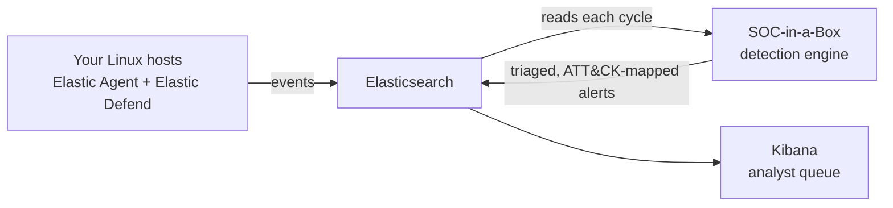

# SOC-in-a-Box

**An open-source, AI-enabled security operations platform for Digital Public Infrastructure, built by the Upanzi Network at CMU-Africa.**

SOC-in-a-Box adds machine-learning detection and AI agents to an Elastic Stack,
so a small security team can run a Security Operations Center without building
one from scratch. It is aimed at Digital Public Infrastructure (DPI), Digital
Public Goods, e-government and financial services, especially in African
markets.

- **Runs on modest hardware.** CPU only, so data can stay in-country.
- **AI assists the analyst.** High-impact actions stay behind human approval or
  dry-run defaults.
- **One core, optional add-ons.** Add only what you need.
- **Also a training lab** for students and SOC analysts.



## What's included

| Component | What it does | |
|---|---|---|
| **Detection engine** | Learns normal behaviour per host, user and process, and writes what does not fit to Kibana as filtered alerts mapped to MITRE ATT&CK. Needs at least 7 days of host data to learn from before it can start detecting | Core, always installed |
| **SIEM Maintenance Agent** | Watches Elasticsearch itself: cluster health, logs still arriving, a daily Google Chat report, optional automatic fixes | Optional add-on |
| **Alert Triage Agent** | Investigates Elastic Security alerts and says whether each looks like a real attack or a false alarm, and why. Web page, API and MCP server: [find out more](addons/alert-triage/README.md) | Optional add-on |
| **Greenbone scan results** | Sends Greenbone (OpenVAS) vulnerability scans to Elasticsearch weekly, labelled new, fixed or unchanged | Optional add-on (needs Greenbone) |

## Prerequisites

- A Linux server with Python 3.10 or newer
- An Elastic Stack 8.x (Elasticsearch, Kibana, Fleet). No stack yet?
  `sudo bash install-elastic-stack.sh` sets one up on a single Ubuntu server,
  or install it yourself: see [Install the Elastic Stack](docs/elastic-stack.md).
- Elastic Agent on the Linux hosts you want to monitor, with the
  **Elastic Defend** and **System** integrations, and about 7 days of their data

## Installation

**With the script (recommended).** On the Linux server:

```bash
git clone https://github.com/cylab-africa/SOC-in-a-Box-ELK-ML-AgenticAI-.git
cd SOC-in-a-Box-ELK-ML-AgenticAI-
./deploy.sh
```

It asks a few questions, installs and starts everything, and ends with a
summary. Details and options: [Installation](docs/installation.md).

**By hand.** Every step the script runs, one at a time:
[Manual installation](docs/manual-installation.md).

**Add-ons later.** `./deploy.sh --only maintenance` (or `triage`, `greenbone`):
see [Add-ons](docs/add-ons.md).

## Documentation

| Guide | What's in it |
|---|---|
| [Install the Elastic Stack](docs/elastic-stack.md) | Setting up Elasticsearch, Kibana and Fleet, with the script or by hand, and adding hosts |
| [Installation](docs/installation.md) | Install with `deploy.sh`, options, checking it works |
| [Manual installation](docs/manual-installation.md) | Installing the detection engine by hand |
| [Add-ons](docs/add-ons.md) | Installing and running the three add-ons |
| [Configuration](docs/configuration.md) | `.env` settings, index names, false-positive lists |
| [Troubleshooting](docs/troubleshooting.md) | Common errors and fixes |
| [Detection engine](docs/detection-engine.md) | What it detects and how |
| [Architecture](docs/architecture.md) | Pipeline stages and where this sits in a SOC |
| [Technical reference](docs/technical-reference.md) | In-depth reference for the detection engine |
| [Development](docs/development.md) | For contributors: layout, tests, linting |

## Security

Report vulnerabilities privately as described in [SECURITY.md](SECURITY.md).
Never post credentials, hostnames or IP addresses from your environment in a
public issue.

## License

MIT. See [LICENSE](LICENSE).
