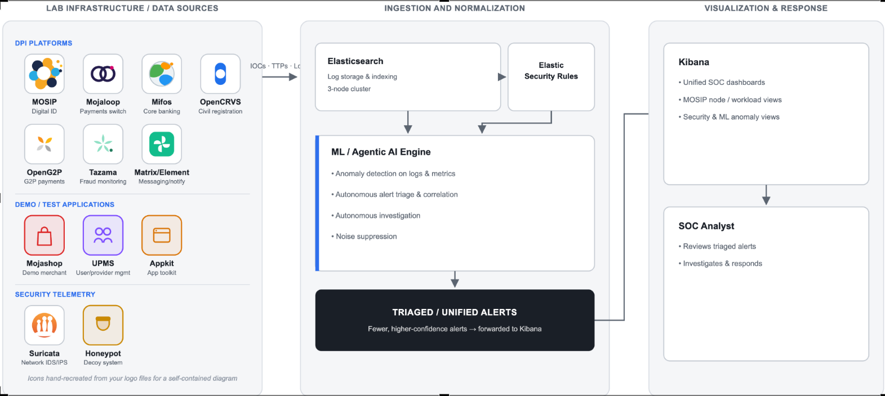
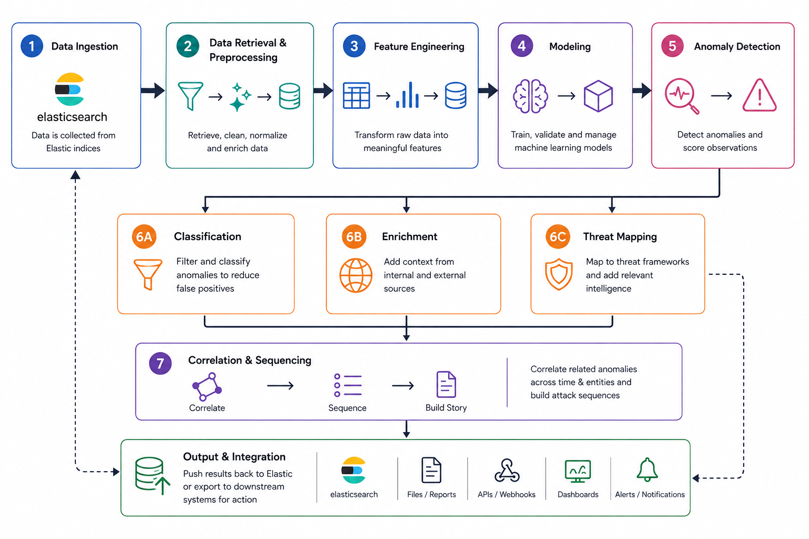

# Architecture

This document covers how the system is built and where it sits in a larger SOC
deployment. If you are trying to get it running, start with the
[installation guide](installation.md) instead — this is background, not setup.

## Contents

- [Where this fits: the SOC platform](#where-this-fits-the-soc-platform)
- [Detection pipeline](#detection-pipeline)
- [The feedback loops](#the-feedback-loops)
- [Module map](#module-map)

## Where this fits: the SOC platform



This project is the **ML / Agentic AI Engine** in the middle column of the
diagram above. The surrounding platform is a SOC-in-a-Box deployment built
around a digital public infrastructure (DPI) lab, and it works in three stages.

### 1. Lab infrastructure and data sources (left)

Everything that produces telemetry. Three classes of source feed the pipeline:

- **DPI platforms** — MOSIP (digital identity), Mojaloop (payments switch),
  Mifos (core banking), OpenCRVS (civil registration), OpenG2P (government-to-person
  payments), Tazama (fraud monitoring), and Matrix/Element (messaging and
  notification). These are the production-shaped workloads the SOC is defending.
- **Demo / test applications** — Mojashop (demo merchant), UPMS (user and
  provider management), and Appkit (application toolkit). These generate
  realistic user-driven traffic and are also where controlled attack simulations
  are run.
- **Security telemetry** — Suricata (network IDS/IPS) and a honeypot decoy
  system. These contribute signature hits, network flow records, and
  high-confidence attacker interactions.

Each source ships host and application logs, plus IOCs and observed TTPs, into
the ingestion layer.

### 2. Ingestion, normalization, and detection (middle)

- **Elasticsearch** — a 3-node cluster that stores and indexes every log stream.
  It is the single source of truth for the pipeline: this project reads its
  input from ES indices and writes its output back to ES.
- **Elastic Security Rules** — the signature and rule-based detection layer.
  It catches *known* bad behavior — matching IOCs, documented TTPs, and
  established rule logic.
- **ML / Agentic AI Engine (this repository)** — the layer that catches what
  rules cannot: behavior that is *unusual for this environment* rather than
  known-bad in general. It performs anomaly detection over logs and metrics,
  autonomous alert triage and correlation, autonomous investigation of the
  raw events behind each anomaly, and noise suppression.

The two detection layers are complementary. Rules give precision on known
threats; the ML engine gives coverage of novel and living-off-the-land activity.
Both converge on a single output.

- **Triaged / unified alerts** — the engine's deliverable. Instead of forwarding
  every raw model hit, it emits a smaller set of higher-confidence alerts:
  false positives filtered out, related anomalies merged into one narrative, and
  each alert enriched with the context an analyst needs to make a decision.

### 3. Visualization and response (right)

- **Kibana** — unified SOC dashboards, per-node and per-workload views for the
  DPI platforms, and dedicated security and ML anomaly views. Because the engine
  writes back into Elasticsearch ML anomaly indices, its output appears natively
  in Kibana alongside rule-based alerts.
- **SOC analyst** — reviews the triaged alerts, investigates, and responds. The
  entire point of the noise-suppression and correlation stages is to keep this
  queue small enough that a human can work it meaningfully.

## Detection pipeline



The diagram above is the internal flow of this repository — what actually runs
between "logs land in Elasticsearch" and "an alert reaches Kibana". Each stage
maps to specific modules in the codebase (all under `engine/`).

**1. Data ingestion** — Data is collected from Elastic indices. Index patterns,
time windows, and query shape are all configuration-driven, so the pipeline can
be pointed at a new environment without code changes.
→ `datamanager.py`, `.env` (see [configuration.md](configuration.md))

**2. Data retrieval and preprocessing** — Retrieve, clean, normalize, and enrich
the raw documents. Field names are normalized across log sources, incomplete
records are dropped or defaulted, timestamps are aligned, and entities (host,
user, process, IP) are resolved to a consistent identity so downstream stages
can join on them.
→ `datamanager.py`

**3. Feature engineering** — Transform normalized events into the numeric
features the models consume. This is where behavior becomes measurable:
per-entity rarity, command-line characteristics, session and timing patterns,
port and protocol profiles, and volume aggregates over rolling windows.
→ `detection_methods.py`

**4. Modeling** — Train, validate, version, and load the ML models. The pipeline
pairs two detectors — Isolation Forest and Local Outlier Factor — because each is
sensitive to a different shape of outlier. Models are trained per data group (process,
network, user, discovery, metadata, auth, host) and persisted with versioning so
scoring is reproducible.

Models are fit per entity (a host, a user, a process name), and an entity needs
at least 50 observations before it gets a model
of its own. Entities below that threshold are skipped and logged.
→ `model_manager.py`, `detection_methods.py`, `train_models_background.py`

The `models/` (PyOD ensemble) and `dl_models/` (AutoEncoder and other deep
learning models) packages are experimental and not yet wired into this stage.

**5. Anomaly detection** — Score live observations against the trained models.
Every score is normalized to `[0.0, 1.0]`, so scores are directly comparable
across models and data groups. Thresholds then decide what counts as anomalous,
adjusting for business hours, recent false-positive pressure, and score
escalation.
→ `anomaly_detector.py`, `push_all_anomalies.py`

Stages 6A, 6B, and 6C run over the resulting anomalies. They are drawn in
parallel because they are independent transformations of the same anomaly set.

**6A. Classification** — Filter and classify anomalies to reduce false
positives. Known infrastructure daemons, non-interactive service accounts,
internal and cloud IP ranges, and expected public ports are all recognized and
either suppressed or down-weighted. The allowlist is graduated rather than
binary: repeat benign behavior is dampened over time instead of being
permanently whitelisted, so a compromised "known good" process can still surface.
→ `push_all_anomalies.py` (filtering), `benign_lists.py`, `config/*.txt`

**6B. Enrichment** — Add context from internal and external sources. Each
anomaly is cross-referenced back against the raw process, network, and
authentication logs that produced it, so the alert carries the actual command
line, source and destination IPs, parent process, and user — not just a score.
This is what makes an alert triageable without pivoting to another tool.
→ `push_all_anomalies.py` (enrichment)

**6C. Threat mapping** — Map each detection to threat frameworks and attach
relevant intelligence. Every detection capability carries at least one MITRE
ATT&CK technique ID (see the coverage table in [detection-engine.md](detection-engine.md#what-it-detects)), which gives analysts
a common vocabulary and lets the correlation stage reason about attack progression.
→ `push_all_anomalies.py` (MITRE enrichment), `config.py`

**7. Correlation and sequencing** — Correlate related anomalies across time and
entities, order them, and build an attack story. Rather than reporting a rare
process, an unusual outbound connection, and an odd sudo call as three separate
alerts, this stage links them per entity across ATT&CK stages and emits one
kill-chain narrative. This is the single biggest reduction in analyst workload.
→ `post_correlation.py`

**8. Output and integration** — Push results back to Elasticsearch or export to
downstream systems for action: ES ML anomaly indices, file and report exports,
and Kibana dashboards. Output destinations sit behind a backend interface
(`backends/base.py`); Elasticsearch is the implemented backend and the one the
pipeline uses.
→ `push_all_anomalies.py`, `backends/`

## The feedback loops

The two dashed arrows in the diagram matter as much as the forward path:

- **Output back to ingestion** — results written to Elasticsearch become inputs
  on the next cycle. Confirmed detections and analyst dispositions inform benign
  list dampening and threshold adaptation, so the pipeline gets quieter and more
  accurate the longer it runs in a given environment.
- **Threat mapping back to output** — ATT&CK context travels with the alert all
  the way to the destination system, so the technique attribution is present in
  Kibana and in any downstream integration, not just internally during scoring.

## Module map

```
                    +------------------+
                    |  Data Sources    |
                    |  (ES Indices)    |
                    +--------+---------+
                             |
                    +--------v---------+
                    |  Data Manager    |
                    |  (datamanager.py)|
                    +--------+---------+
                             |
               +-------------+-------------+
               |                           |
    +----------v----------+     +----------v----------+
    |  Feature Extraction |     |  Model Training     |
    |  (detection_        |     |  (model_manager.py) |
    |   methods.py)       |     |                     |
    +----------+----------+     +----------+----------+
               |                           |
               +-------------+-------------+
                             |
                    +--------v---------+
                    | Anomaly Detector |
                    | (anomaly_        |
                    |  detector.py)    |
                    +--------+---------+
                             |
          +------------------+------------------+
          |                  |                  |
+---------v------+ +--------v-------+ +--------v--------+
| FP Classifier  | | Source Enrich  | | MITRE Enrichment|
| (push_all_     | | (push_all_     | | (push_all_      |
|  anomalies.py) | |  anomalies.py) | |  anomalies.py)  |
+---------+------+ +--------+-------+ +--------+--------+
          |                  |                  |
          +------------------+------------------+
                             |
                    +--------v---------+
                    | Kill-Chain       |
                    | Correlation      |
                    | (post_           |
                    |  correlation.py) |
                    +--------+---------+
                             |
                    +--------v---------+
                    | Backend Push     |
                    | (Elasticsearch)  |
                    +------------------+
```
