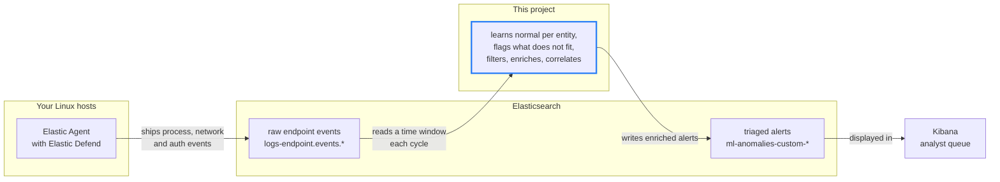
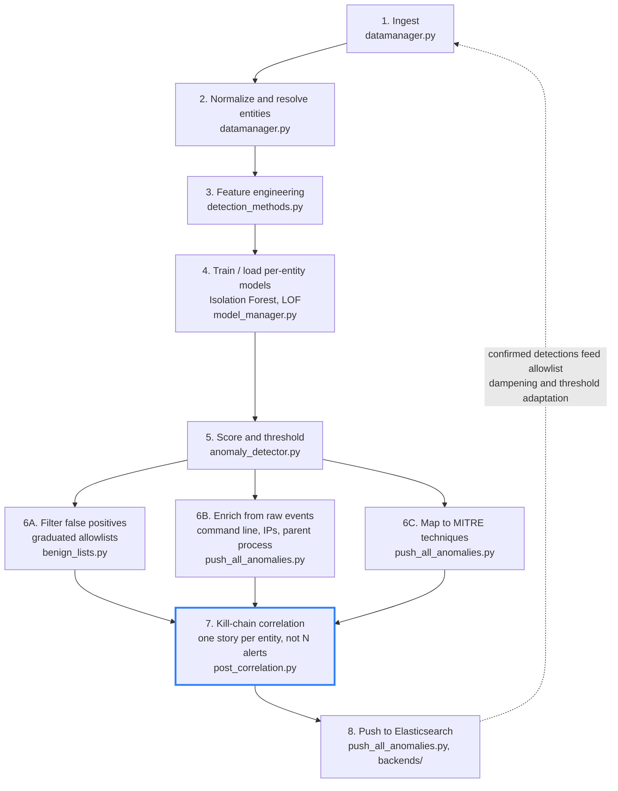

# The detection engine

**Finds suspicious activity on Linux servers that rule-based detection misses, and sends it to Kibana as triaged alerts.**

Security rules catch things that are *known* to be bad. This catches things that
are *unusual for your environment* — a process that has never run on that host
before, a login at an hour that user never works, an outbound connection on a
port nothing else uses. It learns what normal looks like from your own logs,
then reports what does not fit.

It is built to reduce noise, not add to it. Anomalies are filtered against
allowlists, enriched with the actual command line and IP addresses behind them,
mapped to MITRE ATT&CK techniques, and grouped into a single story per host
rather than arriving as a dozen separate alerts.

Here is where it sits:

Everything outside the "This project" box already exists in a normal Elastic
deployment. The detection engine is the new piece, and it never runs on the machines
being watched — it only needs network access to Elasticsearch.

## What it detects

7 data groups (process, network, user, discovery, metadata, auth, host) across
20 detection jobs. Each entity (host, user, process, port) gets its own
Isolation Forest and Local Outlier Factor models, with a statistical fallback
where the models cannot separate normal from unusual. Every detection maps to at
least one MITRE ATT&CK technique:

| Technique | ID | Detection Job |
|-----------|----|---------------|
| Command and Scripting Interpreter | T1059 | rare_process_on_host, suspicious_cmd_chains |
| Valid Accounts | T1078 | rare_user_activity, anomalous_login_times |
| Abuse Elevation Control | T1548 | rare_sudo_usage |
| Network Service Scanning | T1046 | host_discovery_patterns |
| Application Layer Protocol | T1071 | unusual_connections |
| Non-Standard Port | T1571 | anomalous_ports |
| Ingress Tool Transfer | T1105 | (suspicious command regex) |
| Brute Force | T1110 | brute_force_detection |
| Masquerading | T1036 | rare_process_host_combo, rare_metadata_process |
| DNS over Application Layer | T1071.004 | rare_dns_queries |
| Protocol Tunneling | T1572 | unusual_connections |

The short names in this table are descriptions; job IDs are the `v3_*` names
that appear in your logs and in `results/` filenames.

Other capabilities: source-event enrichment (pulls the real command line and IPs
behind each anomaly), graduated allowlists that dampen repeat benign behavior
instead of permanently whitelisting it, kill-chain correlation across ATT&CK
stages, and alert thresholds that account for business hours and recent
false-positive pressure.

## How it works

Eight stages run between "a log lands in Elasticsearch" and "an alert reaches an
analyst". Stages 6A-6C are drawn in parallel because they are independent
transformations of the same anomaly set:

Stage 7 is the one that decides whether an analyst can actually work the queue.
A rare process, an odd outbound connection, and an unusual sudo call on the same
host arrive as one narrative rather than three unrelated alerts.

The dashed arrow is why the system gets quieter over time: what it confirms on
one cycle shapes what it suppresses on the next.

For each stage in detail, where this sits in a full SOC deployment, and the
module map, see [architecture.md](architecture.md).
