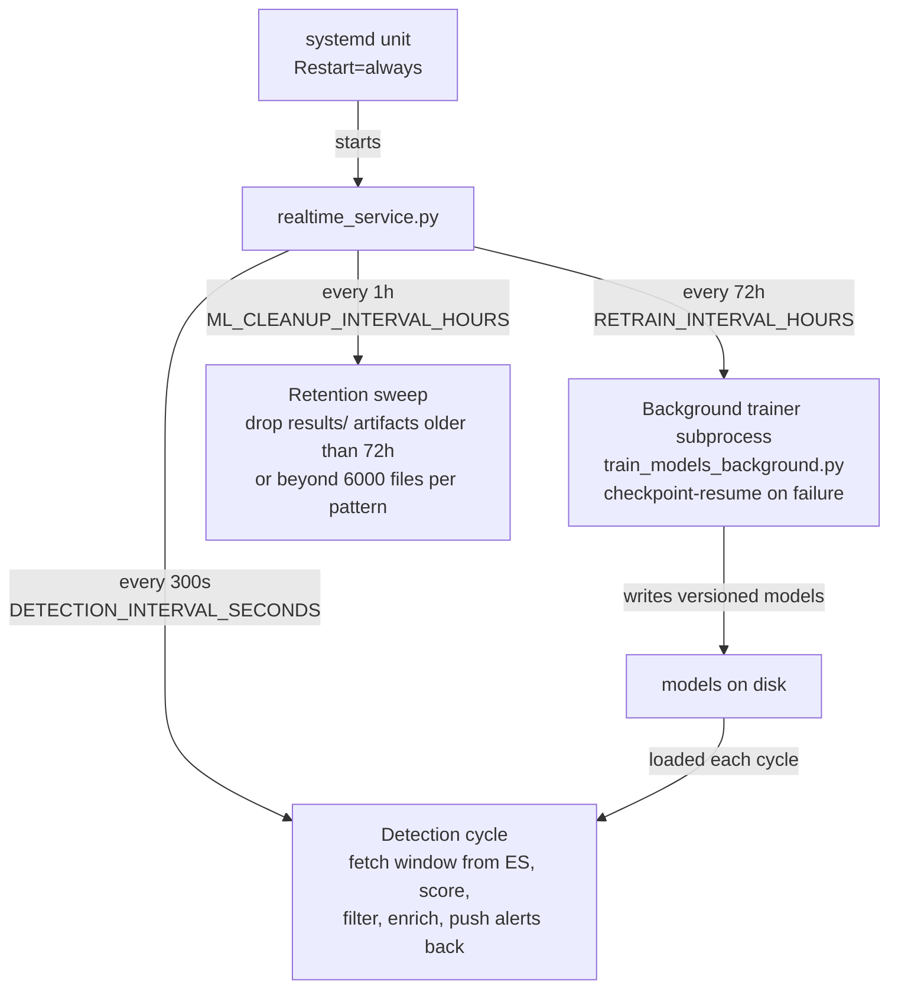

# Installation

This guide is for anyone standing up SOC-in-a-Box against **their own**
Elasticsearch cluster and environment. Each step ends with how to tell it worked
before you move on.

- [Before you start](#before-you-start)
- [Step 1 — Have an Elastic Stack with endpoint data](#step-1--have-an-elastic-stack-with-endpoint-data)
- [Step 2 — Install with deploy.sh](#step-2--install-with-deploysh)
- [Step 3 — Confirm alerts reach Kibana](#step-3--confirm-alerts-reach-kibana)
- [Docker](#docker)
- [Manual install](#manual-install)
- [Running it as a service](#running-it-as-a-service)

Configuration is covered in [configuration.md](configuration.md), the optional
agents in [add-ons.md](add-ons.md), and problems in
[troubleshooting.md](troubleshooting.md).

## Before you start

This is **not** a standalone tool. It reads from an existing Elasticsearch
cluster and does nothing useful without one. Here is the honest list.

| Requirement | Why | How to check |
|---|---|---|
| **Python 3.10 or newer** | Uses 3.10+ type syntax | `python3 --version` |
| **An Elasticsearch 8.x cluster** you can reach, with a username and password | This is both the input and the output | `curl -u USER:PASS https://YOUR_ES:9200` |
| **Elastic Agent installed on the Linux machines you want to watch**, with the **Elastic Defend** integration enabled | Produces the process and network events the models learn from | See below |
| **At least 7 days of that data already collected** | Models need history to learn "normal"; 7 days is the default training window for process data | See below |

### The part people miss

The models do not read `/var/log` or run on the machine being monitored. They
read **Elastic Agent data streams** out of Elasticsearch. Specifically:

| Data stream | Comes from | Used for |
|---|---|---|
| `.ds-logs-endpoint.events.process-default-*` | Elastic Defend integration | process detection |
| `.ds-logs-endpoint.events.network-default-*` | Elastic Defend integration | network detection |
| `.ds-logs-endpoint.events.file-default-*` | Elastic Defend integration | file activity |
| `.ds-logs-system.auth-default-*` | System integration | login / sudo detection |

So before anything here will work, you need Elastic Agent enrolled in Fleet on
your Linux hosts with **Elastic Defend** (for endpoint events) and **System**
(for auth logs) added to its policy.

## Step 1 — Have an Elastic Stack with endpoint data

<!--
  Elastic installer: when installers/elastic-soc.sh lands, add it here as the
  first option ("Install the Elastic Stack on this host"), with its success
  output: "Elasticsearch: status=green ...", "Kibana: active",
  "Fleet Server agent: active".
-->

Choose one:

- **You already run Elastic Security.** Use that cluster. Nothing to install.
- **You have no cluster yet.** Follow Elastic's
  [Elastic Security setup guide](https://www.elastic.co/docs/solutions/security/get-started)
  to install Elasticsearch, Kibana and Fleet Server, then enroll Elastic Agent on
  your Linux hosts with the **Elastic Defend** and **System** integrations.
- **You only want to try it out.** `./deploy.sh --mode docker --local-es`
  starts a bundled Elasticsearch 8.12 and Kibana 8.12 for you. It does **not**
  include Elastic Agent, so you still need to enroll an agent against it to get
  endpoint data.

**✅ Check:** this returns a count in the thousands or more.

```bash
curl -u "$ES_USERNAME:$ES_PASSWORD" \
  "$ES_HOST/.ds-logs-endpoint.events.process-default-*/_count"
```

- **`{"count":0,...}`** → Elastic Agent is not shipping endpoint data yet. Fix
  that first; nothing downstream will produce results.
- **`index_not_found_exception`** → the integration has never run, or your
  cluster names its indices differently (see
  [configuration.md](configuration.md#index-names-and-field-names)).
- **Have the cluster but no history yet?** Install the agent, then come back in
  a week. You can still complete Step 2 now; detections start once there is
  enough data.

## Step 2 — Install with deploy.sh

`deploy.sh` does the install, `.env` setup, connectivity check, and service
setup in one pass, and asks whether to add each optional
[add-on](add-ons.md):

```bash
git clone https://github.com/cylab-africa/SOC-in-a-Box-ELK-ML-AgenticAI-.git
cd SOC-in-a-Box-ELK-ML-AgenticAI-
./deploy.sh --dry-run        # see what it would do first; changes nothing
./deploy.sh                  # interactive
```

It asks for your Elasticsearch URL and credentials, checks the cluster answers,
installs the engine in `.venv/`, and starts `realtime_service.service` under
systemd.

**✅ You should see** `[ OK ]` lines for each stage and a summary at the end:

```
== Done ==
  Detection pipeline:   venv
  Maintenance add-on:   no
  Triage add-on:        no
```

A `[FAIL]` line stops the script and says what went wrong. It is safe to re-run:
existing `.env` files are kept unless you pass `--reconfigure`.

Models are not trained by the script: the service starts a background training
run on its first cycle, and detections begin once it finishes. To train up
front instead, see [Manual install](#manual-install), step 4.

### What deploy.sh sets up

| What | venv mode (default) | `--mode docker` |
|---|---|---|
| Detection engine | `.venv/`, `pip install -e .`, `realtime_service.service` | `detection` container |
| Maintenance add-on (`--with-maintenance`) | `addons/siem-maintenance/.venv/`, `siem-maintenance.service` | `siem-maintenance` container (`maintenance` profile) |
| Triage add-on (`--with-triage`) | `addons/alert-triage/.venv/`, `alert-triage.service` on `127.0.0.1:8000` | `alert-triage` container (`triage` profile), published on `127.0.0.1:8000` |
| Elasticsearch | your cluster (`ES_HOST`) | your cluster, or the bundled one with `--local-es` |

Steps it runs:

1. Preflight: Python 3.10+ and venv support (or Docker Compose v2), curl.
2. Asks which add-ons to install (skip the questions with `--with-maintenance` /
   `--no-maintenance` and `--with-triage` / `--no-triage`).
3. Writes `.env` from `.env.example` with your ES URL, credentials, and index
   patterns, then checks the cluster answers. Credentials are passed to curl
   on stdin, never on the command line, and are only sent over a verified TLS
   connection. For a private CA set `ES_CA_CERT=/path/to/ca.pem`; for a lab
   cluster with a self-signed certificate pass `--insecure-tls` (or
   `ES_INSECURE_TLS=1`). Without either, an untrusted certificate is reported
   and no credentials are sent.
4. For each add-on chosen, writes its `.env` reusing the same ES settings.
5. Installs dependencies and (venv mode) systemd units, or builds and starts
   the containers.

Unattended example (CI, Ansible, cloud-init):

```bash
ES_HOST=https://10.0.4.12:9200 ES_USERNAME=detector ES_PASSWORD="$ES_PASSWORD" \
GC_ALERT_WEBHOOK="$CHAT_WEBHOOK" MAINTENANCE_IANA_TIMEZONE=Africa/Kigali \
  ./deploy.sh --non-interactive --with-maintenance
```

In `--non-interactive` mode every prompt takes its value from the environment
variable of the same name (`ES_HOST`, `ES_USERNAME`, `ES_PASSWORD`,
`ES_PROCESS_INDEX`, `KIBANA_HOST`, `GC_ALERT_WEBHOOK`, `LLM_PROVIDER`,
`LLM_MODEL`, `OPENAI_API_KEY`, `ANTHROPIC_API_KEY`, `AUTO_REMEDIATION_DRY_RUN`,
...) or its default. Run `./deploy.sh --help` for every option.

## Step 3 — Confirm alerts reach Kibana

Check these four in order. The first one that fails tells you where to look.

| # | Check | Command | ✅ Expected |
|---|---|---|---|
| 1 | Input data exists | `curl -u U:P "$ES_HOST/.ds-logs-endpoint.events.process-default-*/_count"` | count > 0 |
| 2 | Models trained | `grep "Successfully trained" logs/trainer.log` | one line per group |
| 3 | Detection ran | `grep "Anomalies detected" logs/linux_anomaly_detection.log \| tail -1` | a non-zero number |
| 4 | Output reached ES | `curl -u U:P "$ES_HOST/ml-anomalies-custom-*/_count"` | count > 0 |

Then add `ml-anomalies-custom-*` as a data view in Kibana to see the alerts.

Two quick checks you can run straight after `deploy.sh`, before any training:

```bash
.venv/bin/python engine/main.py --list-jobs              # confirms ES connectivity and job registration
.venv/bin/python engine/push_all_anomalies.py --dry-run  # shows what would be pushed, pushes nothing
```

## Docker

```bash
cp .env.example .env   # set ES_HOST, ES_USERNAME, ES_PASSWORD
docker compose --env-file .env -f docker/docker-compose.yml up
```

This starts three services (`docker/docker-compose.yml`):

- `elasticsearch` / `kibana` — a local Elasticsearch 8.12 + Kibana 8.12 stack,
  useful for a demo/dev environment. To use an existing cluster instead, run the
  `detection` service alone with the `external-es` override
  (`./deploy.sh --mode docker` does this for you):

  ```bash
  docker compose --env-file .env \
    -f docker/docker-compose.yml -f docker/docker-compose.external-es.yml \
    up -d --build --no-deps detection
  ```
- `detection` — builds from `docker/Dockerfile`, reads `.env` via
  `env_file: ../.env`, and runs `engine/realtime_service.py` by default.

Add `--profile maintenance` or `--profile triage` to also start the add-on
containers (they need the add-on `.env` files, which `deploy.sh` writes).

Passing `--env-file .env` explicitly (as above) avoids version-dependent
ambiguity in where Compose looks for `.env` for `${VAR}` substitution in
the compose file itself (e.g. `${ES_PASSWORD}`) — always run it from the
repo root.

`config/` is bind-mounted into the container (`../config:/app/config`, which
includes `config/local/`), so editing the `.txt` files on the host takes effect
without rebuilding the image — only code changes require a rebuild.

## Manual install

What `deploy.sh` automates, step by step. Run every command from the repo root;
the engine's scripts live in `engine/`.

### 1. Install

```bash
git clone https://github.com/cylab-africa/SOC-in-a-Box-ELK-ML-AgenticAI-.git
cd SOC-in-a-Box-ELK-ML-AgenticAI-
python3 -m venv .venv && source .venv/bin/activate
pip install -e .
```

**✅ Worked if:** `python -c "import anomaly_detector"` prints nothing (no error).

### 2. Point it at Elasticsearch

```bash
cp .env.example .env
```

Open `.env` and set these three. Everything else has a working default:

| Variable | What to put |
|---|---|
| `ES_HOST` | Full URL including scheme and port, e.g. `https://10.0.0.5:9200` |
| `ES_USERNAME` | An ES user that can read your log indices and write new ones |
| `ES_PASSWORD` | That user's password |

**✅ Worked if:** the `curl` command in [Step 1](#step-1--have-an-elastic-stack-with-endpoint-data)
returns a count using these credentials.

### 3. Check your index names match

This is the single most common reason a run produces nothing. The defaults in
`.env.example` match a standard Elastic Agent install. If your cluster names
things differently, see
[configuration.md](configuration.md#index-names-and-field-names).

**✅ Worked if:** every `ES_*_INDEX` pattern in `.env` matches at least one real
index on your cluster.

### 4. Train the models

Start with a dry run. It confirms the tool and your data-group configuration
load correctly without touching Elasticsearch or training anything:

```bash
python engine/train_models_background.py --all --dry-run
```

Then train for real. This reads up to 7 days of history and takes a while:

```bash
python engine/train_models_background.py --all
```

Useful flags: `--groups process network` to train only some groups,
`--skip-existing` to resume, `--restart-on-fail` to retry automatically.

**✅ Worked if:** `logs/trainer.log` contains lines like:

```
Successfully trained and saved models for process
 Saved 3 baselines
```

Seeing `Insufficient samples for <name>: 1 < 50` is **normal** — that entity
doesn't have enough history for its own model yet. Only worry if *every* entity
reports it, which means not enough data overall.

### 5. Run detection once

```bash
python engine/main.py
```

Add `--data-groups process` to test a single group first, or
`--detection-mode single --job v3_linux_anomalous_process_all_hosts` for one
job. Job IDs are the `v3_*` names that appear in your logs and in `results/`
filenames.

**✅ Worked if:** `logs/linux_anomaly_detection.log` contains a summary like:

```
Detection Summary:
  Total records: 2,301
  Anomalies detected: 270
  Anomaly rate: 11.73%
```

and new files appear in `results/` named `ml_only_<group>_data_*.csv` and
`ml_only_<group>_report_*.md`.

### 6. Send alerts to Kibana

```bash
python engine/push_all_anomalies.py --dry-run   # shows what would be pushed
python engine/push_all_anomalies.py
```

This is the step that applies false-positive filtering, adds context, maps to
ATT&CK, correlates into kill chains, and writes to Elasticsearch.

**✅ Worked if:** the `ml-anomalies-custom-*` indices exist and have documents:

```bash
curl -u "$ES_USERNAME:$ES_PASSWORD" "$ES_HOST/ml-anomalies-custom-*/_count"
```

Then add `ml-anomalies-custom-*` as a data view in Kibana to see them.

## Running it as a service

Once a one-shot run works, run it as a service instead:

```bash
python engine/realtime_service.py
```

It loops detection, pushes results, retrains in the background, and cleans up
its own old output. One process, three schedules:



Detection and training are deliberately separate: training is slow and
occasional, detection is fast and constant, so a long retrain never stalls the
detection loop. All three intervals are environment variables — override them in
the unit file if the defaults do not suit your volume.

`deploy.sh` installs the systemd unit for you. To do it by hand, save this as
`/etc/systemd/system/realtime_service.service`, adjusting `User` and the paths:

```ini
[Unit]
Description=Realtime Anomaly Detection Service
After=network.target

[Service]
Type=simple
User=YOUR_USER
WorkingDirectory=/opt/SOC-in-a-Box-ELK-ML-AgenticAI-
Environment=PYTHONUNBUFFERED=1
ExecStart=/opt/SOC-in-a-Box-ELK-ML-AgenticAI-/.venv/bin/python -u /opt/SOC-in-a-Box-ELK-ML-AgenticAI-/engine/realtime_service.py
Restart=always
RestartSec=5

[Install]
WantedBy=multi-user.target
```

Then `sudo systemctl enable --now realtime_service`.

**✅ Worked if:** `systemctl status realtime_service` shows `active (running)`.

This service is chatty; consider adding `StandardOutput=null` and reading
`logs/` instead, or capping journal size with `SystemMaxUse` in
`/etc/systemd/journald.conf`.
